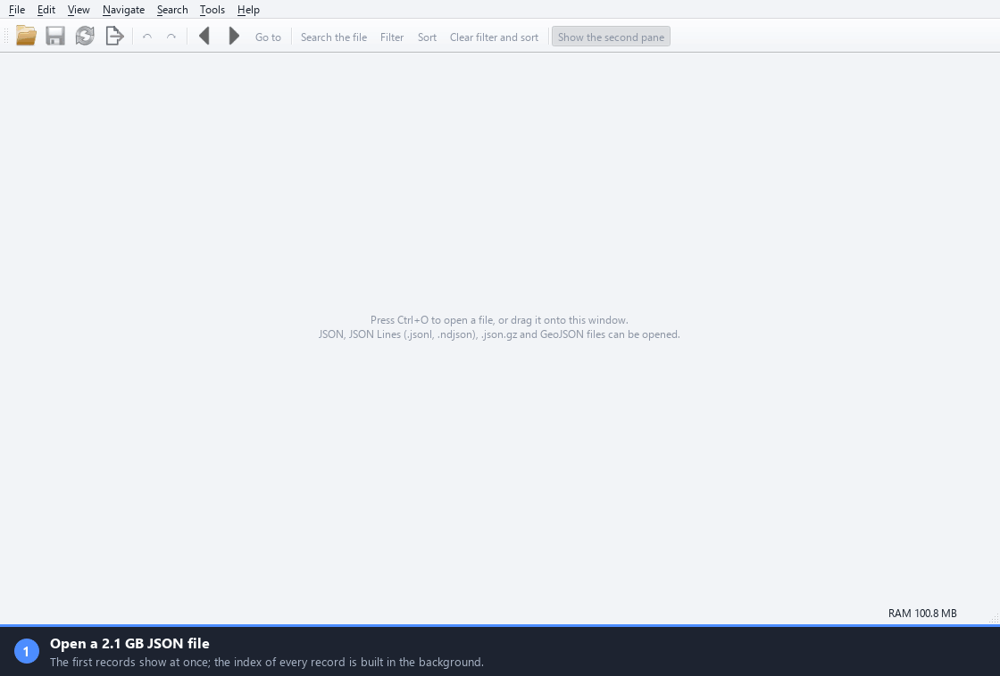
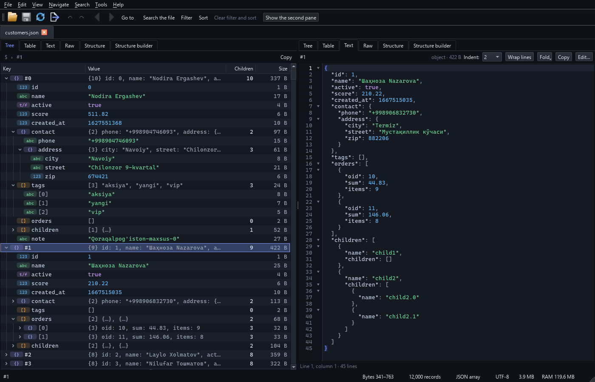
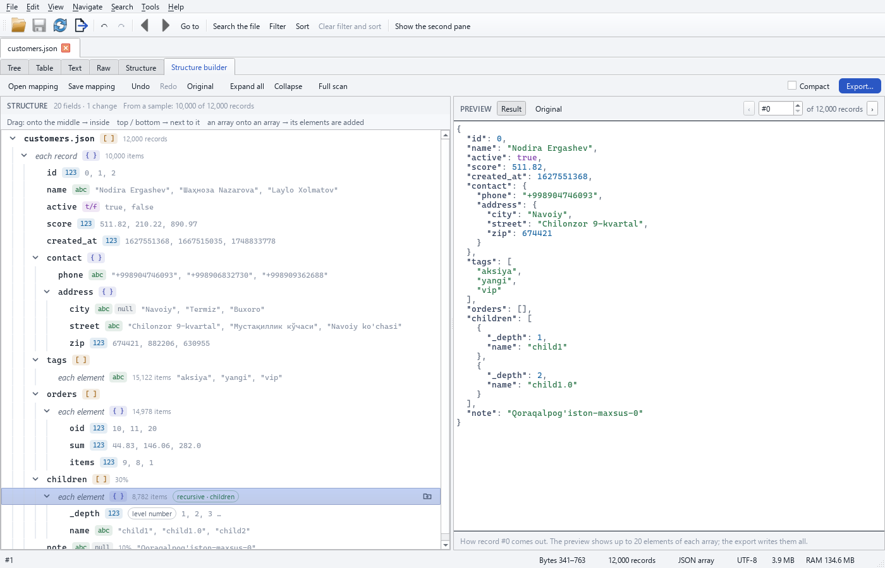
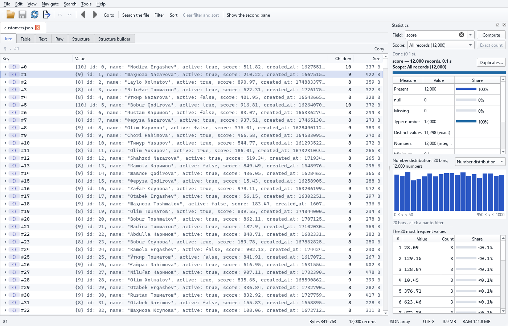
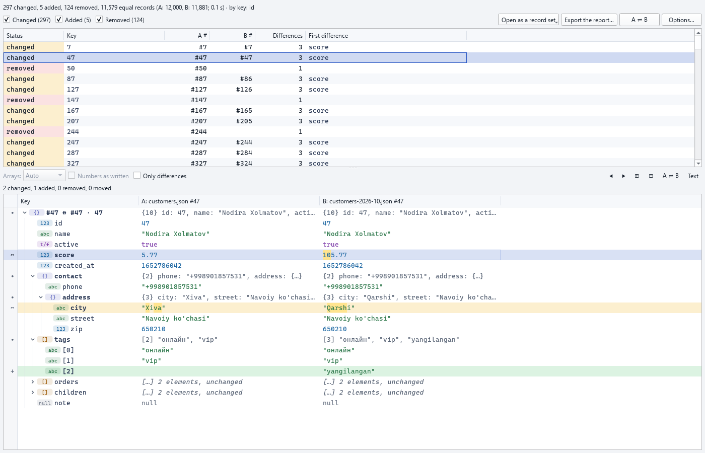
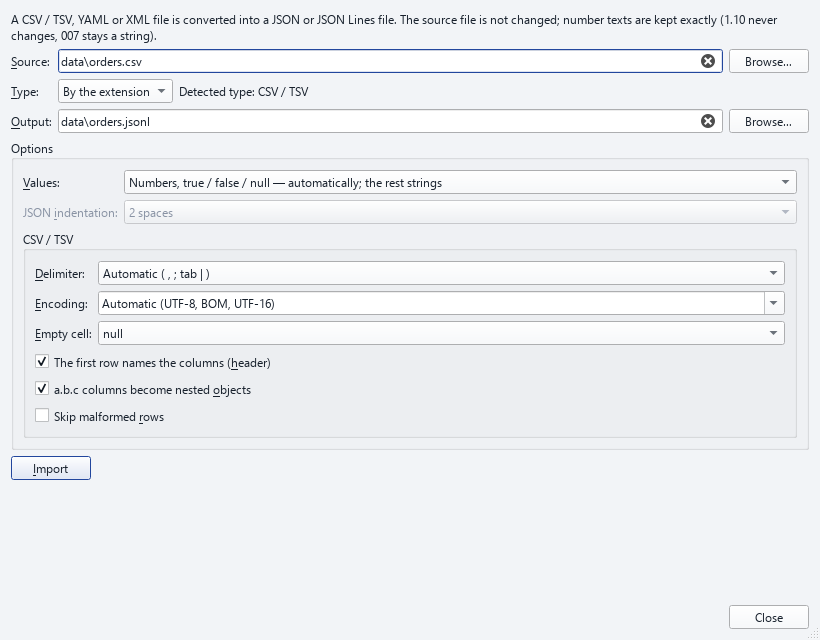
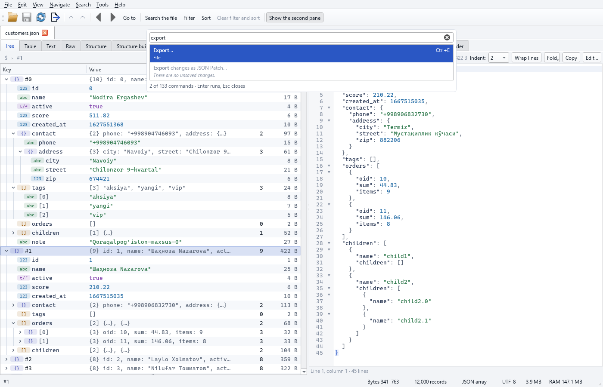

# jsonreshape

[English](README.md) | [O'zbekcha](README.uz.md) | **Русский**

[](https://github.com/Erkinbek/jsonreshape/actions/workflows/ci.yml) [](LICENSE)   

Настольное приложение и CLI для огромных файлов JSON (от 100 MB до нескольких GB): просмотр, поиск, фильтрация,
сортировка, преобразование, редактирование, перестройка структуры, статистика, дубликаты, JSON Schema,
разделение / объединение, исправление и сравнение.
**Файл никогда не загружается в память целиком**: он один раз индексируется (байтовые границы каждой записи), а
затем читаются только нужные части. **Исходный файл никогда не изменяется**: правки живут в отдельном слое, а
сохранение атомарно заменяет файл новым (по умолчанию с резервной копией `.bak`).



*Файл 2,1 GB с 6,5 млн записей: открытие, просмотр, поиск по всем записям, фильтр и экспорт в CSV. Часы под окном
показывают реальное время (только фильтр ускорен в 8 раз, и это написано в строке под окном); записано без экрана
скриптом `scripts/make_demo_gif.py`.*

> **Статус: готово** — 6 основных этапов (2026-10-19) и этап распространения и расширений (этап 7, 2026-10-21). Автор: Erkin Pardayev · создано с помощью Claude Opus 5.5
> ([автор, контакты и авторские права](#muallif)).

|  |  |
|:--:|:--:|
| Светлая тема | Тёмная тема |

*Просмотрщик: слева дерево со значками типов и размерами в байтах, справа выбранная запись текстом — реальное окно
1400 × 900 (английский интерфейс; по умолчанию узбекский), отрисовано без экрана скриптом `scripts/make_screenshots.py`.*

| # | Этап | Статус |
|---|---|---|
| 1 | **Ядро**: чтение + индекс (ядро на Rust и запасная реализация на Python), RecordSet, поиск, фильтр, сортировка, запись, CLI (`inspect`, `search`, `filter`, `sort`, `convert`) | ✅ готово |
| 2 | **GUI для просмотра** (PySide6): дерево, таблица, текст, байты, вид «Структура», навигация, панель поиска, конструктор фильтров, сортировка, экспорт, фоновые задачи, строка состояния | ✅ готово |
| 3 | **Редактирование**: правка узлов (значение, ключ, тип, вставка, удаление, дублирование, перемещение, перетаскивание), массовые операции (с точным подсчётом заранее), JSON Patch, отменить/повторить, слой правок (SQLite + файлы сегментов, непрерывное автосохранение и восстановление), безопасное сохранение, CLI `patch` | ✅ готово |
| 4 | **Конструктор структуры**: движок маппинга (результаты идентичны `json-tuzilma.html`), GUI (перетаскивание, живой предпросмотр), файлы маппинга, CLI `apply`, `flatten` | ✅ готово |
| 5 | **Инструменты**: статистика полей, дубликаты, JSON Schema (создание и проверка), разделение / объединение / извлечение, исправление, сравнение (diff), «умные» значения; CLI `stats`, `dupes`, `schema`, `validate`, `split`, `merge`, `extract`, `repair`, `diff` | ✅ готово |
| 6 | **Полировка**: палитра команд, настройка сочетаний клавиш, восстановление сессии, файлы рабочего пространства, темы, «Открыть с помощью» в Windows, `.exe` через PyInstaller; рабочие процессы для тяжёлых экспортов; итоговый бенчмарк | ✅ готово |
| 7 | **Распространение и расширения**: Apache-2.0, конвейер CI / релизов (установщик exe, wheel-пакеты), экспорт Parquet и Feather / Arrow IPC, импорт CSV/YAML/XML, Python API, русский интерфейс, гистограммы статистики, stdin, быстрый экспорт XLSX/SQLite (≥ 50 MB/s) | ✅ готово |

---

## Содержание

1. [Установка](#ornatish)
2. [Быстрый старт (CLI)](#tez-boshlash-cli)
3. [Графический интерфейс (GUI)](#gui)
4. [Поддерживаемые форматы](#formatlar)
5. [Точность чисел](#raqamlar-aniqligi)
6. [Поиск](#qidiruv)
7. [Язык фильтров](#filtr-tili)
8. [Сортировка](#tartiblash)
9. [Экспорт и преобразование](#eksport)
10. [Индекс, кеш и память](#indeks)
11. [Ошибки и журналы](#xatolar)
12. [Архитектура](#arxitektura)
13. [Тесты](#testlar)
14. [Измерения (бенчмарк)](#olchovlar)
15. [Решения и открытые вопросы](#qarorlar)
16. [Автор, контакты и авторские права](#muallif)

---

<a id="ornatish"></a>
## 1. Установка

Требования: Windows 10/11 (работает также на Linux/macOS), **Python 3.11+** (проверено на 3.14),
а для быстрого ядра — **Rust** (stable) и Visual Studio Build Tools (MSVC).

```powershell
py -3.14 -m venv .venv
.venv\Scripts\python -m pip install -U pip maturin
.venv\Scripts\maturin develop --release          # собирает ядро на Rust и устанавливает пакет
.venv\Scripts\python -m pip install -e ".[dev]"  # инструменты для тестов (pytest, hypothesis, openpyxl ...)
```

Программа работает и без Rust: есть версия ядра на чистом Python (fallback), которая даёт точно такие же результаты
(проверяется тестами), только медленнее. Чтобы включить её принудительно: `JSONRESHAPE_BACKEND=python`
(или `--backend python` в CLI).

Для графического интерфейса: `.venv\Scripts\python -m pip install -e ".[gui]"` (PySide6).
Для экспорта в Parquet и Feather / Arrow IPC нужен необязательный пакет `pyarrow`:
`pip install "jsonreshape[parquet]"` (программа работает и без него; такой экспорт тогда подсказывает, как его
установить).

Запуск: `jsonreshape ...` (CLI) или `python -m jsonreshape ...`; GUI — `jsonreshape-gui [file ...]`
или `python -m jsonreshape.gui` ([раздел 3](#gui)).

### Готовые сборки (GitHub Releases)

У каждой версии есть свои файлы на странице [Releases](https://github.com/Erkinbek/jsonreshape/releases):

| Файл | Что это |
|---|---|
| `jsonreshape-<version>-setup-x64.exe` | Установщик для Windows (Inno Setup): для текущего пользователя (без прав администратора) или для всех пользователей; ярлык в меню «Пуск», по желанию ярлык на рабочем столе и команда `jsonreshape` в PATH; удаление через Параметры ▸ Приложения. |
| `jsonreshape-<version>-windows-x64.zip` | Windows, портативная версия: распакуйте в любое место и запустите `jsonreshape-gui.exe` (окно) или `jsonreshape.exe` (командная строка); у обоих общая папка `_internal\`. |
| `jsonreshape-<version>-linux-x86_64.tar.gz`, `jsonreshape-<version>-macos-arm64.tar.gz` | Linux / macOS (Apple silicon), портативная версия: `tar xzf …`, затем `jsonreshape/jsonreshape-gui` или `jsonreshape/jsonreshape`. |
| `*.whl`, `jsonreshape-<version>.tar.gz` | Пакет Python (3.11+): `pip install <file>`; `pip install "jsonreshape[gui]"` добавляет окно. |
| `SHA256SUMS.txt` | Проверка загруженного файла: `sha256sum -c SHA256SUMS.txt --ignore-missing` (Linux / macOS) или `Get-FileHash <file>` (PowerShell). |

**PyPI** (после первой публикации): `pip install jsonreshape` — один wheel с ядром на Rust для каждой платформы
(Windows x64, Linux x86_64, macOS universal), работающий с любым Python ≥ 3.11; на остальных платформах sdist
собирает ядро на Rust сам (без Rust используется чистое Python-ядро). **winget** (после слияния pull request в
winget-pkgs): `winget install Erkinbek.jsonreshape`.

Сборки пока не подписаны кодовой подписью: Windows SmartScreen может предупредить при первом запуске
(«Подробнее» ▸ «Выполнить в любом случае»). Программа ничего не отправляет по сети, каким бы способом она ни была
установлена.

### `.exe` для Windows (запуск без установки Python)

```powershell
powershell -ExecutionPolicy Bypass -File scripts\build_exe.ps1
# -SkipTests: только сборка; -NoInstall: не использовать pip; -Installer: также установщик Inno Setup; -Sign <thumbprint>: кодовая подпись
```

Скрипт устанавливает PyInstaller (6.22.3) в venv (доступ к сети нужен только на этом шаге; сама программа работает
автономно), создаёт иконку, собирает по `packaging\jsonreshape.spec` и запускает smoke-тесты на готовом exe
(`-m packaging`). Результат — папка `dist\jsonreshape\` (~78 MB): `jsonreshape-gui.exe` (окно) и
`jsonreshape.exe` (CLI) используют одну общую папку `_internal\`; передавайте пользователям папку целиком. Запуск:
CLI ~0,10 s, окно GUI ~0,28 s. Вручную:

```powershell
.venv\Scripts\python -m pip install "pyinstaller==6.22.3" "pyinstaller-hooks-contrib==2026.8"
.venv\Scripts\python packaging\make_icon.py build\jsonreshape.ico
.venv\Scripts\python -m PyInstaller --noconfirm --clean --distpath dist --workpath build\pyinstaller packaging\jsonreshape.spec
.venv\Scripts\python -m pytest -q -m packaging tests\test_packaging.py
```
Программа ничего не отправляет по сети (ни телеметрии, ни проверки обновлений).

<a id="tez-boshlash-cli"></a>
## 2. Быстрый старт (CLI)

Команды ниже работают **одинаково в cmd.exe, Windows PowerShell 5.1, PowerShell 7 и bash**
(строки, начинающиеся с `#`, — комментарии; не вводите их в терминал).
Правило: выражение берите в двойные кавычки (`"..."`), а любой текст внутри него — в одинарные (`'...'`).

```text
# Сведения о файле: формат, кодировка, число записей, скорость индексации, структура (выборка: 10 000 записей)
jsonreshape inspect data.json --sample 10000

# Поиск: по ключам и значениям, без учёта регистра, варианты апострофа считаются одинаковыми
jsonreshape search data.json "O'zbekiston"
# Без различия латиницы и кириллицы: Тошкент тоже находится
jsonreshape search data.json Toshkent --translit
jsonreshape search data.json toshkent --path contact.address.city --values
jsonreshape search data.json "^Tosh.*t$" --regex
jsonreshape search data.json "> 1000" --number
# все совпадения в файл CSV
jsonreshape search data.json maxsus --export results.csv

# Фильтр (безопасный язык выражений или JMESPath); сохранённые фильтры (предустановки)
jsonreshape filter data.json tashkent.json --where "contact.address.city == 'Toshkent' and len(children) > 2"
jsonreshape filter data.json top.json --jmespath "active && score > to_number('100')"
jsonreshape filter data.json tashkent.json --where "contact.address.city == 'Toshkent'" --save-preset toshkent
jsonreshape filter data.json tashkent.csv --preset toshkent
# список сохранённых фильтров
jsonreshape presets

# Сортировка (одно или несколько полей; "-" означает порядок по убыванию)
jsonreshape sort data.json sorted.json --by name --by -id

# Преобразование (+ необязательные фильтр и сортировка)
jsonreshape convert data.json data.jsonl
# пересобрать объект с ключами из JSONL-формы файла-словаря (строки {"key": value})
jsonreshape convert keyed.jsonl keyed.json --as-keyed
jsonreshape convert data.json table.csv --columns "id,name,contact.address.city"
jsonreshape convert data.json table.xlsx --array-mode rows --explode orders
jsonreshape convert data.json db.sqlite
# Parquet и Feather / Arrow IPC (.feather или .arrow); необязательный pyarrow: pip install "jsonreshape[parquet]"
jsonreshape convert data.json data.parquet
jsonreshape convert data.json data.feather --feather-compression lz4
jsonreshape convert data.json pretty.json --indent 4 --sort-keys --where "active == true" --sort-by -score
# только выбранные записи (нумерация с 0: 0:100 = 0..99) или один узел
jsonreshape convert data.json selection.csv --select "0:100,500"
jsonreshape convert data.json orders.json --node "#5.orders"

# JSON Patch (RFC 6902): результат записывается в новый файл в том же формате и кодировке, что и входной файл
jsonreshape patch data.json fix.patch.json result.json
# сначала создаётся data.json.bak; --no-backup
jsonreshape patch data.json fix.patch.json --in-place

# Применить маппинг, сохранённый в конструкторе структуры, ко всему файлу (потоково, в параллельных процессах)
jsonreshape apply structure.mapping.json data.json new.json
# развернуть вложенные списки children в один список с номером уровня (_depth)
jsonreshape flatten data.json flat.jsonl --children-key children

# Статистика, дубликаты, JSON Schema
jsonreshape stats data.json --field contact.address.city
jsonreshape stats data.json --where "active == true" --json
jsonreshape stats data.json --field score --histogram --bins 20
jsonreshape dupes data.json --key id --top 10 -o dupes.jsonl
jsonreshape schema data.json data.schema.json --strict
jsonreshape validate data.json --schema data.schema.json --export errors.csv

# Разделение, объединение, извлечение
# или --size 500MB / --records 100000; -o папка
jsonreshape split data.json --parts 10
# программа раскрывает шаблон сама
jsonreshape merge "part_*.json" -o all.jsonl --dedupe-by id
jsonreshape extract big.json items.json --path data.items
jsonreshape extract data.json orders.jsonl --gather "orders[*]"

# Исправление (исходный файл не изменяется) и сравнение
# --check: только проверка
jsonreshape repair broken.json repaired.json --report fixes.csv
jsonreshape diff old.json new.json --key id --exit-code

# Импорт: CSV / TSV, YAML или XML -> JSON Lines (по умолчанию) или массив JSON (.json); числа сохраняют свой текст
jsonreshape import data.csv data.jsonl
jsonreshape import data.csv data.json --indent 4
jsonreshape import table.tsv -o table.jsonl --no-header --types string
jsonreshape import export.csv -o export.jsonl --delimiter ";" --encoding cp1251 --skip-bad
jsonreshape import config.yaml config.json
jsonreshape import catalog.xml -o catalog.jsonl --record-tag item

# Стандартный ввод: "-" вместо INPUT (конвейеры); см. примечание об оболочках ниже
curl -s https://example.com/data.json | jsonreshape convert - data.jsonl
jsonreshape inspect - < data.json.gz
```

Если JMESPath нужен литерал вроде `` `100` ``: используйте строку в одинарных кавычках в PowerShell
(``--jmespath 'score > `100`'``), двойные кавычки в cmd.exe (``--jmespath "score > `100`"``)
или запишите выражение без литерала: `to_number('100')`.

Общие параметры ввода: `--record-path data` (для объекта, содержащего большой массив; `data[0]`,
`/data/0`, `data.0` тоже работают), `--format auto|array|jsonl|brace_list|wrapped|keyed|single|stream`,
`--allow-partial` (при ошибке JSON работать с записями до места ошибки), `--no-cache`.
Глобальные: `--lang uz|en|ru`, `--backend auto|rust|python`, `-q`, `-v`/`-vv`, `--version`.

**Стандартный ввод:** `-` вместо INPUT читает стандартный ввод — в каждой команде с одним INPUT и как один из
входов `merge` / `diff`; результаты всегда файлы (`-` как результат отклоняется). Данные сначала копируются
блоками по 1 MiB во временный файл в рабочей папке (`%LOCALAPPDATA%\jsonreshape\tmp` или папка `tmp`
настроенной папки кеша) со строкой хода выполнения, затем открываются как обычный файл: `--format`,
`--record-path` и распознавание gzip работают как обычно, а информационная строка сообщает, сколько байтов
прочитано. Временный файл удаляется по завершении команды, в том числе после ошибки. Поскольку длина конвейера
неизвестна, в папке должно оставаться 64 MiB свободного места сверх уже прочитанных байтов (проверка каждые
256 MiB). `-` отклоняется, когда стандартный ввод — терминал; `split -` требует `-o DIR`, `import -` требует
`--from csv|yaml|xml`, `patch --in-place` с `-` не работает. Оболочки: cmd.exe и bash передают байты конвейера
или перенаправления `<` без изменений; Windows PowerShell 5.1 (и PowerShell 7 до 7.4) перекодирует конвейер как
текст, что портит gzip и не-ASCII данные, и не имеет `<` — там укажите имя файла или используйте PowerShell 7.4
и новее.

Коды выхода:

| Код | Значение |
|---|---|
| `0` | успех |
| `1` | ошибка пользователя: недопустимая команда / параметр / выражение, файл не найден, несуществующий `--record-path` (предлагаются найденные пути к массивам), выходной файл совпадает с входным |
| `2` | ошибка JSON во входном файле (показываются строка / столбец / байт и их окружение) **или** файл был изменён другой программой во время работы (результат не сохраняется) |
| `3` | отменено (Ctrl+C / Ctrl+Break) — частичный выходной файл не остаётся |
| `4` | внутренняя ошибка (краткое сообщение и путь к файлу журнала) |
| `5` | несоответствие данных: `validate` нашёл ошибки или `diff --exit-code` нашёл различия |

Полный список параметров каждой команды: `jsonreshape COMMAND --help` (на узбекском; `--lang en` — на английском,
`--lang ru` — на русском).
В PowerShell и bash пишите `$key` в одинарных кавычках: `'$key'`.

Исходный файл **никогда не изменяется сам по себе**: все результаты записываются в отдельный файл под временным
именем и атомарно подменяются в конце; если выходной файл — это входной файл (даже под другим написанием или через
ссылку), операция отклоняется. Сам файл заменяется только по явному запросу (`patch --in-place`, **Сохранить** в
GUI): после проверки новой копии, атомарно и по умолчанию с резервной копией `.bak`. Если входной файл меняется во
время работы (другая программа перезаписывает его либо удаляет и создаёт заново), это обнаруживается, и
повреждённый результат не записывается.

<a id="gui"></a>
## 3. Графический интерфейс (GUI)

```text
jsonreshape-gui
jsonreshape-gui big.json other.jsonl
python -m jsonreshape.gui big.json
```

Требуется PySide6 (`pip install -e ".[gui]"`). Файлы можно также перетащить на окно или открыть через
**Файл → Открыть** (Ctrl+O); ведётся список **Файл → Недавние файлы**. Первые записи появляются сразу после
открытия файла (пока индекс строится в фоне), а число записей обновляется на лету.

### Устройство окна

* Каждый файл открывается в своей **вкладке**. Внутри вкладки рядом расположены **две панели** (по умолчанию:
  Дерево | Текст); каждая панель выбирает свой вид: **Дерево, Таблица, Текст, Байты, Структура** (Ctrl+1…5). Виды
  связаны: узел, выбранный в одном, выбирается и в другом (а также ячейка таблицы, курсор в тексте, байты).
* Панели сообщений в верхней части вкладки: ошибка JSON (строка, столбец, байт, причина; **Перейти к ошибке**;
  записи до места ошибки остаются открытыми), список повреждённых строк в JSON Lines, предупреждения о формате,
  путь к записям (`data`) и его изменение, а также **Открыть заново**, когда файл изменён другой программой.
* Пока показан результат фильтра, сортировки или поиска, баннер сообщает «Вид: Фильтр … · записей: 22 / 300» с
  кнопкой **Показать все**.
* **Строка состояния**: размер файла, число записей (с процентом индексации), формат и путь к записям, кодировка,
  текущий путь, выделение, диапазон байтов узла, память (RAM), фоновые задачи.
* Боковые панели: **Поиск** (Ctrl+Shift+F), **Фильтр** (Ctrl+Shift+L), **Фоновые задачи** (для каждой задачи: %,
  MB/s, оставшееся время, «Отменить»).

### Виды

* **Дерево.** Записи — `#0`, `#1`, … (нумерация с 0); в файле-словаре — ключи; в файле с обёрткой
  (`{"meta": …, "data": […]}`) первая строка — «(обёртка)». Столбцы: ключ (значок и цвет типа), значение, число
  дочерних элементов, размер (байты). → раскрывает, ← сворачивает, `*` раскрывает всё (при более чем 1 000 строк
  сначала спрашивает), «Раскрыть до уровня» (1–9), «Свернуть всё». Большой узел (например, 1 миллион дочерних
  элементов) индексируется в фоне и показывается виртуально. Сверху — путь со ссылками (breadcrumb). Раскрытые
  узлы остаются раскрытыми при смене фильтра или сортировки. Сортировка только для вида: ключи объектов по
  алфавиту, элементы массива по полю (исходные индексы показываются). Space открывает окно полного значения.
* **Таблица.** Записи — строки, поля — столбцы (вложенные тоже: `contact.address.city`). Столбцы берутся из
  структуры автоматически; диалог «Столбцы…» выбирает и упорядочивает их и добавляет собственный путь; меню
  заголовка скрывает столбец или закрепляет первый столбец. Раскладка запоминается для каждого файла (и пути к
  записям). Ячейки массивов / объектов показывают `[3]` / `{5}`; двойной щелчок открывает их в дереве. Щелчок по
  заголовку сортирует (повторный щелчок — по убыванию, Shift добавляет вторичный ключ). Быстрые фильтры под
  заголовком (Alt+↓): `Toshkent` (содержит), `=12`, `!=x`, `>5`, `<=5`, `5..10`, `~regex`, `null`, `!null`,
  `exists`, `missing`, `empty`. Ctrl+C копирует выделенные ячейки как TSV (для вставки в Excel).
* **Текст.** Выбранный узел в отформатированном виде: подсветка цветом, номера строк, свёртка скобок, перенос
  строк, отступ 2 / 4 / tab. Числа и строки остаются байт в байт как в файле (`1e400`, `1.10`, `-0.0`). Узел под
  курсором выбирается и в дереве. Для текста больше 4 MB показывается начало; чтобы увидеть его целиком,
  используйте «Открыть в виде „Байты“».
* **Байты.** Байты файла постранично (файл целиком не читается): смещение в байтах и номер строки, «Перейти к
  смещению» (`123456`, `0x1E240`), «Перейти к строке», место ошибки JSON отмечается.
* **Структура (Schema view).** Дерево полей: распределение типов, % присутствия, примеры, диапазоны длин / чисел;
  по выборке из 10 000 записей или по «Полному проходу» (в фоне). Меню: добавить как столбец таблицы, фильтр
  «есть» / «отсутствует», сортировка, добавить в конструктор фильтров.

### Навигация

* **Ctrl+G**: `data[120].contact.address`, `$.data[120]`, `/data/120`, `#120`, `#120.contact`.
* **Alt+← / Alt+→** — история выделения; **Ctrl+B** — закладка (именованная, сохраняется; с этапа 3 Ctrl+D —
  «Дублировать»), **Ctrl+Shift+D** — список закладок.
* Контекстное меню каждого узла: копировать значение (JSON с отступами / компактный, Python, строка CSV),
  копировать путь (с точками `a.b[0].c`, JSONPath, JSON Pointer, Python `["a"]["b"][0]`, JavaScript), копировать
  ключ; «Фильтр по этому значению», «Сортировать по этому полю ↑/↓», «Показать в дереве», «Открыть в новой
  вкладке», значение целиком.

### Поиск, фильтр, сортировка

* **Быстрый поиск** (Ctrl+F) в видах «Дерево», «Таблица», «Текст» и «Байты», в загруженной части; F3 / Shift+F3.
* **Полный поиск** (Ctrl+Shift+F): по ключам / значениям / по тем и другим, при желании только в заданном пути;
  обычный текст, регулярное выражение, число (`> 1000`); с учётом регистра, целое слово, латиница ↔ кириллица;
  варианты апострофа всегда считаются одинаковыми. Результаты появляются по мере нахождения; щелчок по результату
  переходит к узлу; «Открыть как набор записей»; экспорт всех результатов в CSV/JSON; история поиска. Поиск не
  запускается, пока ещё выполняется фильтр или сортировка (вас просят дождаться готовности вида).
* **Фильтр** (Ctrl+Shift+L): визуальный конструктор (поле + оператор + значение; группы AND / OR / NOT) и строка
  выражения (язык выражений или JMESPath) — изменение одного обновляет другое; именованные сохранённые фильтры.
  Результат вычисляется в фоне и показывается по мере заполнения.
* **Сортировка** (Поиск → Сортировка…): несколько полей, по возрастанию / по убыванию, `null` в конце или в
  начале, естественный порядок (`child2 < child10`), узбекский алфавит (по умолчанию) / простой / Unicode.
* Фильтр и сортировка одинаково применяются ко всем видам и к экспорту; когда открыт результат поиска, фильтр и
  сортировка работают с этими записями.

### Экспорт (Ctrl+E)

JSON (отступ 2 / 4 / tab / компактно, сортировка ключей, сохранить обёртку, пересобрать объект с ключами), JSONL,
CSV, XLSX, SQLite. Область: текущий вид (фильтр + сортировка), все записи, выбранные записи, текущий узел
(узел-массив или узел-объект — также в CSV/XLSX/SQLite) или набор записей, полученный другим инструментом
(например, дубликаты). «Сохранить обёртку» работает во всех форматах; результат с именем `.gz` сжимается. Запись в
сам исходный файл (в том числе под другим именем или через ссылку) не допускается. Экспорт выполняется в фоне: он
продолжается, даже если закрыть диалог или открыть файл заново; в конце — отчёт (записи, файлы, предупреждения).

### Редактирование (этап 3)

Исходный файл **не изменяется** во время редактирования: каждое изменение записывается в отдельный *слой правок*,
а файл заменяется проверенной новой копией атомарно и только когда вы нажимаете **Сохранить**.

* **На узле** (в дереве и таблице): **Enter** — изменить значение (короткое значение прямо в ячейке, длинный
  текст в отдельном окне; число открывается в исходном написании — `1.10` не превращается в `1.1`);
  **Shift+Enter** — как текст JSON (проверка на лету, строка и столбец ошибки отмечаются, «Форматировать»);
  **F2** — переименовать ключ; **Ins** — вставить (внутрь / перед / после: ключ, тип, значение); **Del** — удалить;
  **Ctrl+D** — дублировать; **Alt+↑ / Alt+↓** — переместить; **Ctrl+V** — вставить JSON из буфера обмена;
  «Изменить тип» в меню (только возможные типы). Ошибки — существующий ключ, недопустимое число или недопустимый
  JSON — сообщаются прямо в поле ввода или в строке состояния (диалог ошибки не открывается). В дереве записи и
  элементы можно перетаскивать мышью (перед / внутрь / после). При нескольких выделенных узлах (Shift / Ctrl):
  удалить, дублировать и переместить — до 10 000; для большего числа используйте массовые операции.
* **В таблице** редактируется ячейка именно этого столбца (поле, которого нет в записи, добавляется); F2 в столбце
  `$key` меняет ключ записи в файле-словаре; `$index` только для чтения.
* **Отменить** Ctrl+Z, **повторить** Ctrl+Y / Ctrl+Shift+Z. Каждое действие (массовая операция тоже) — один шаг,
  показанный по имени в меню («Отменить: …»); по умолчанию 1 000 шагов (настройка, не меньше 200).
* **Массовые операции** (Ctrl+H): найти и заменить (обычный текст или регулярное выражение, при желании в
  заданном пути), переименовать ключ, удалить поле, задать поле (всегда / если отсутствует / если есть), очистить
  строки (пробелы по краям и лишние пробелы), преобразовать тип, удалить дубликаты (по ключу, оставляя первый или
  последний). Область: все записи, текущий вид (фильтр / сортировка) или выбранные записи. Сначала
  **Предпросмотр**: точное число записей, которые изменятся, 5 примеров (до → после) и проблемы; затем
  **Применить** — результат точно совпадает с подсчитанным числом.
* **JSON Patch** (RFC 6902): Правка → «Импорт JSON Patch…» (один шаг; если хоть одна операция не удаётся, ничего
  не меняется) и «Экспорт изменений как JSON Patch…» (итоговая разница с исходным файлом).
* **Сохранить** (Ctrl+S) выполняется в фоне. Файл записывается в его собственном формате (массив, объект с
  ключами, обёртка, JSONL, поток, одиночное значение), кодировке (UTF-8, BOM, UTF-16), сжатии (gzip) и с его
  атрибутами (скрытый, системный, сжатие NTFS); неизменённые записи копируются байт в байт. Новый файл сначала
  записывается во временный файл и проверяется сканером ядра (число записей тоже), затем ставится на место
  исходного одной атомарной операцией. По умолчанию старый файл остаётся как `file.json.bak` (настройка это
  отключает). Значение, набранное в открытом поле ввода, применяется перед сохранением. Если на этом файле
  выполняется экспорт или другая фоновая задача, сохранение ждёт её (или останавливает — вас спрашивают).
  **Сохранить как** (Ctrl+Shift+S) записывает в другой файл (имя `.gz` означает gzip); перезапись файла, открытого
  в другой вкладке с несохранёнными изменениями, отклоняется.
* **Автосохранение и восстановление.** Каждый шаг сразу записывается на диск (SQLite WAL + файлы сегментов с
  контрольными суммами, fsync): изменения не теряются, даже если программа или компьютер выключится. При следующем
  открытии файла появляется панель: «Найдены несохранённые изменения: время, шагов: N» — восстановить, отказаться
  или сохранить как JSON Patch. Если сохранение было прервано на середине (даже если файл пропал) — **Завершить
  сохранение**: решение основано на фактах (идентичность файла, время, размер, хеши); при сомнении ничего не
  удаляется, а файлы перечисляются по именам. Если файл был изменён другой программой, предлагается сохранить
  изменения как JSON Patch (их можно применить к новому файлу заново).
* Расположение слоя: `%LOCALAPPDATA%\jsonreshape\edits\` (настройка «Рядом с файлом» — `file.json.jredit\`).
  Файл редактирует только одна вкладка или одно окно одновременно (в том числе через иначе написанный путь или
  ссылку); остальные могут только просматривать его.
* Закрытие вкладки, открытие заново (F5) и выход спрашивают о несохранённых изменениях или о текущем сохранении.
  В заголовках вкладки и окна показывается `*`, в строке состояния — «● изменений: N».
* **Ограничения**: одну запись больше 50 MB нельзя редактировать (массовые операции пропускают её и сообщают
  число); файл с ошибкой JSON (открытый частично) доступен только для чтения — сначала исправьте его
  («Исправить»); файл `brace_list` сохраняется как массив JSON, повреждённые строки в JSONL при сохранении
  отбрасываются, а лишние данные после конца потока gzip (при сохранении без резервной копии) удаляются — обо всех
  трёх случаях сначала спрашивают.

### Конструктор структуры (этап 4, Ctrl+6)

Перестройте структуру записей мышью и примените результат ко всему файлу. Эталон — прототип
`json-tuzilma.html`: результат идентичен ему (проверено приёмочными тестами 1–10 и 4 000 случайных случаев).
Единственные различия вызваны ограничениями JavaScript: числа сохраняются точно (`1.10`, `1e400`,
`12345678901234567890`), порядок ключей не меняется, есть «повторить», номера записей начинаются с 0.



* Кнопка «Конструктор структуры…» в виде «Структура» или Ctrl+6. Слева — дерево структуры (по выборке — по
  умолчанию 10 000 записей — или по всем записям через «Полный проход»); справа — живой результат («Результат» /
  «Оригинал», переключатель записей `‹ #N ›`).
* **Перетаскивание**: на середину строки — внутрь; на её верхний или нижний край — перед или после. Перемещение
  поля изнутри массива наружу — «собрано в список»; перемещение внешнего поля в элемент массива — «повторяется в
  каждом элементе». Новая группа (Ins), переименовать (F2), удалить (Del), поднять содержимое на уровень выше
  (Ctrl+Shift+U), рекурсивное разворачивание (`children` → с номером уровня `_depth`), вверх / вниз
  (Alt+↑ / Alt+↓), переместить (Ctrl+X, Ctrl+V); меню строки показывает каждое действие и причину, по которой оно
  невозможно.
* Каждое изменение отмечается значком (`перемещено`, `исходное имя`, `новая группа`, `рекурсивно`, …); Ctrl+Z /
  Ctrl+Y — собственная история конструктора; «Исходная» (сброс).
* Сохранение маппинга в файл и его открытие; **Экспорт с маппингом** (Ctrl+E): JSON или JSON Lines, весь файл или
  текущий вид; в фоне, в параллельных процессах для больших файлов. CLI: `jsonreshape apply`,
  `jsonreshape flatten`.
* Поля, не встретившиеся в выборке, не попадают в результат (правило эталона) — отчёт экспорта сообщает число
  таких записей; при необходимости используйте «Полный проход».

<a id="asboblar"></a>
### Инструменты (этап 5)

Всё находится в меню **Инструменты**, в меню узла и в соответствующих видах. Тяжёлая работа выполняется в фоне
(с ходом выполнения и отменой); редактируемый файл используется в том виде, как он показан (с его несохранёнными
изменениями); файлы результатов никогда не перезаписывают исходный файл или файл, открытый в другой вкладке с
несохранёнными изменениями.

* **Статистика полей** (Инструменты → «Статистика поля…»; «Статистика» в меню узла, заголовке таблицы и виде
  «Структура»; правая панель): присутствие (есть / `null` / отсутствует), типы, число уникальных значений (точное
  или «≈» с границей погрешности), min / max / среднее / сумма для чисел (в точной записи), длины строк, 20 самых
  частых значений (с долей; для многозначных полей также число записей). Во время вычисления результат обновляется
  каждые ~1 s. Двойной щелчок по значению фильтрует по нему; в меню — фильтры по `null`, отсутствию, типу и длине,
  а также «Показать в дереве». Область: текущий вид или все записи; «Точный подсчёт».
  **Диаграммы.** Под сводкой панель статистики рисует диаграмму поля: для чисел — **гистограмму** (до 32 «удобных»
  интервалов — шаги 1, 2, 2,5 или 5 × 10ᵏ, целочисленные интервалы для целых полей), для строк — **распределение длин
  строк**, а для любого поля — **20 самых частых значений** в виде столбцов с их долей; маленький список переключает
  виды, которые предлагает поле. Наведение на столбец показывает его диапазон, количество и долю (подсказка и строка
  под диаграммой); **щелчок по столбцу гистограммы фильтрует вид по этому диапазону** (`age >= 20 and age <= 29`,
  `score >= 0.5 and score < 1`, `len(name) >= 3 and len(name) <= 4` — быстрый фильтр по полю, следующий щелчок
  заменяет его), щелчок по столбцу частого значения — по значению (`city == "Toshkent"`). Гистограмма точна, пока в
  поле не более 65 536 различных чисел; сверх этого она строится по равномерной случайной выборке из 65 536 значений,
  масштабированной к общему количеству (помечается «≈», подсказка говорит об этом). Числа остаются точными: `1e400` и
  `12345678901234567890` сохраняют свой текст в подписях интервалов и в фильтрах. Диаграмма следует за живым
  результатом, пока статистика считается. В CLI `stats --histogram` печатает те же гистограммы под каждым полем (числа
  и длины строк; `--bins N` — не больше N интервалов, 1–4096, по умолчанию 32, включает `--histogram`); с `--json` у
  каждого поля появляются `histogram` и `length_histogram` (`bins`, точные `edges`, `counts`, `exact`, `sample_size`;
  `null`, если в поле нет чисел / строк). Без параметра вывод не меняется.

  

* **Дубликаты записей** (Инструменты → «Дубликаты записей…», вид «Структура»): ключевое поле (`$key` — ключ
  члена, `$` — вся запись), оставить первый или последний; число дубликатов, 20 примеров групп (щелчок переходит к
  записи; фильтр по группе); «Показать дубликаты» (как набор записей), «Экспорт…», «Удалить дубликаты…» (массовая
  операция: сначала показывает точное число).
* **JSON Schema** (Инструменты → JSON Schema): «Создать схему…» — для всего документа или для одной записи,
  свободную или строгую, из кеша структуры или полным сканированием; «Проверить по схеме…» — файл схемы, область,
  форматы; проблемы перечисляются по мере нахождения (`#record | path | message | keyword`), щелчок по проблеме
  переходит к узлу; «Показать недопустимые записи», экспорт в CSV/JSONL, сводка (по ключевому слову и по пути).
* **Исправление** (Инструменты → «Исправить JSON…»; кнопка на панелях ошибки JSON, повреждённых строк и
  `brace_list`): «Проверить» (ничего не записывает) и «Исправить» — результат записывается в новый файл; отчёт:
  исправления по типам (первое место открывается в виде «Байты»), усечённая часть, место, которое нельзя исправить
  (со строкой, столбцом и `^`), таблица всех исправлений, сохранение отчёта, «Открыть исправленный файл» и при
  необходимости «Сохранить частичный результат».
* **Разделение и объединение** (меню «Инструменты»; меню узла → «Разделить этот узел на части…»). Разделение:
  весь файл, текущий вид или узел; по числу частей, записям на часть или размеру части, с **живым планом** (имена
  частей, записи, размер); формат, шаблон имени, без обёртки, удаление старых частей. Объединение: файлы и открытые
  вкладки (с несохранёнными правками — как показано), изменение порядка, JSON/JSONL, отступ, сортировка ключей,
  сохранение обёртки, удаление дубликатов по ключу.
* **Сравнение** (Инструменты → «Сравнить два файла…»; меню узла → «Отметить для сравнения» / «Сравнить с
  отмеченным узлом»; два выделенных узла → «Сравнить два выбранных»). Файлы сравниваются по ключу, по
  сопоставлению содержимого или по позиции: таблица результатов (статус, ключ, A#, B#, число изменений, первый
  путь) и дерево выбранной пары бок о бок `Key | A | B` — добавленное зелёным, удалённое красным, изменённое
  жёлтым, перемещённое синим; в коротких строках отмечаются изменённые символы; **F7 / Shift+F7** — следующее /
  предыдущее различие; «Только различия», сопоставление элементов массивов (индекс / авто / ключ / без учёта
  порядка), A ⇄ B, режим «Текст»; открыть различающиеся записи как набор записей; экспорт отчёта.

  

* **«Умные» значения** (дерево, таблица, окно полного значения): unix-время и даты ISO получают подпись с
  ташкентским временем и днём недели; URL подчёркиваются, **Ctrl+щелчок** → «Открыть в браузере?» → открывается
  только после вашего подтверждения; цвета `#rgb` / `#rrggbb` получают маленький образец; изображения base64
  получают миниатюру в окне полного значения.
* **Вид «Структура»**: столбец «null / отсутствует» (по выборке или полному проходу — заголовок говорит, по
  какому), доля целых чисел; «Статистика» (также двойным щелчком) и «Дубликаты записей…».

* **Импорт (CSV, YAML, XML)** (Файл → «Импорт (CSV, YAML, XML)…»): преобразует файл CSV / TSV, YAML или XML в
  новый файл JSON Lines или JSON и открывает его в новой вкладке («Открыть результат»). Тип определяется по
  расширению (его можно переопределить); параметры: разделитель (автоматически или `,` `;` табуляция `|`), строка
  заголовка, вложенные столбцы `a.b.c`, кодировка, пропуск повреждённых строк, значения (автоматически числа /
  `true` / `false` / `null` либо всё как текст), пустые ячейки (`null` или `""`), тег записи или путь к записям
  XML, отступ JSON для результата `.json`. Исходный файл никогда не изменяется; результат никогда не записывается
  поверх источника или файла с несохранёнными изменениями; импорт выполняется в фоне с ходом выполнения и кнопкой
  «Остановить»; отчёт показывает записи, преобразованные числа, литералы и пустые ячейки, пропущенные строки и
  предупреждения.

  

### Удобство (этап 6)

* **Палитра команд (Ctrl+Shift+P)** — поле поиска, открывающееся поверх окна: все команды меню («Файл ▸ …»,
  «Инструменты ▸ …»), меню текущего узла («Узел ▸ …»), открытые вкладки («Вкладка: …») и недавние файлы
  («Открыть: …»). В каждой строке — имя команды, её путь в меню и клавиша. Поиск не учитывает регистр, варианты
  апострофа (o' / oʻ / o‘) и различие латиницы и кириллицы («сақлаш» находит и «Saqlash» в узбекском интерфейсе);
  сначала идут имена, начинающиеся с набранного слова, затем совпадения в начале слова, затем последовательности
  букв. При пустом поиске — последние 20 использованных команд. Команда, которую сейчас нельзя выполнить, показана
  серым с указанием причины. Enter выполняет, Esc закрывает.

  

* **Клавиатура** (Настройки ▸ Клавиатура): изменить, убрать или сбросить клавишу любой команды; занятая клавиша
  отклоняется с указанием команды, которой она принадлежит. Собственные клавиши дерева и таблицы (↑↓→←, `*`, Space,
  Enter, F2, Ins, Del, Ctrl+D, Alt+↑/↓, Ctrl+V, Ctrl+C …) не меняются и показываются списком.
* **Восстановление последней сессии.** Когда программа запускается без файла, последняя сессия открывается снова:
  файлы (с выбранным форматом / путём к записям), виды обеих панелей, текущий узел, раскрытые узлы (до 2 000 на
  вкладку), фильтр, быстрые фильтры, сортировка и поисковый запрос. Сессия сохраняется при закрытии окна и каждую
  минуту (защита от неожиданной остановки). Настройки ▸ Общие ▸ «Восстанавливать последнюю сессию»: Всегда (по
  умолчанию) / Спрашивать каждый раз / Никогда. Когда файл передан в командной строке или через «Открыть с
  помощью», открывается только он. Ненайденные файлы пропускаются; несохранённые изменения предлагаются только
  через панель восстановления.
* **Рабочее пространство** (Файл ▸ «Сохранить рабочее пространство…» / «Открыть рабочее пространство…» /
  «Недавние рабочие пространства»): открытые вкладки записываются в файл `*.jrworkspace` — всё, что есть в сессии,
  плюс закладки, столбцы таблицы и дерево конструктора структуры; пути также хранятся относительно файла рабочего
  пространства (он работает и после перемещения папки); файл строго проверяется (при ошибке сообщается JSON
  pointer повреждённой части). Слои правок в рабочее пространство не копируются.
* **«Открыть с помощью» в Windows** (Настройки ▸ Общие): добавить jsonreshape в список «Открыть с помощью» для
  файлов `.json`, `.jsonl`, `.ndjson`, `.geojson`, `.gz` или убрать его оттуда (сначала спрашивают). Записывается
  только для текущего пользователя (`HKCU\Software\Classes`), программа по умолчанию не меняется; удаление стирает
  только то, что было записано самой программой.
* **Темы**: как в системе / светлая / тёмная — каждое окно (окна этапов 3–5 тоже) использует только цвета темы и
  обновляется сразу при смене темы.

### Настройки и журналы

**Инструменты → Настройки**: размер выборки, папка кеша и лимит её размера, лимит памяти, память для сортировки,
пороги больших узлов, параметры экспорта по умолчанию, язык (узбекский / английский / русский), тема (как в системе /
светлая / тёмная), моноширинный шрифт и его размер. Журналы: **Инструменты → Открыть папку журналов**; в каждом
диалоге ошибки есть «Открыть журнал».

### Клавиатура

| Клавиша | Действие |
|---|---|
| Ctrl+O / Ctrl+W / F5 / Ctrl+Q | открыть / закрыть вкладку / открыть заново / выход |
| Ctrl+S / Ctrl+Shift+S | сохранить / сохранить как |
| Ctrl+Z / Ctrl+Y (Ctrl+Shift+Z) | отменить / повторить (в конструкторе структуры — его собственная история) |
| Ctrl+1 … Ctrl+6 | в активной панели: Дерево, Таблица, Текст, Байты, Структура, Конструктор структуры |
| ↑ ↓, PgUp PgDn, Home End | перемещение |
| → / ← / `*` | раскрыть узел / свернуть узел / раскрыть всё (дерево) |
| Space | окно полного значения |
| Ctrl+C / Ctrl+Shift+C | копировать значение (в таблице — выделенные ячейки как TSV) / путь |
| Ctrl+F, F3, Shift+F3 | быстрый поиск, следующее / предыдущее совпадение |
| Ctrl+Shift+F / Ctrl+Shift+L | полный поиск / панель фильтра |
| Ctrl+G | перейти к пути |
| Alt+← / Alt+→ | назад / вперёд |
| Enter / Shift+Enter / F2 | изменить значение / править как JSON / переименовать ключ |
| Ins / Del / Ctrl+D | вставить / удалить / дублировать |
| Alt+↑ / Alt+↓ | переместить узел (в дереве) |
| Ctrl+V | вставить JSON из буфера обмена |
| Ctrl+H | массовые операции |
| Ctrl+B / Ctrl+Shift+D | добавить закладку / закладки |
| Ctrl+E | экспорт (в конструкторе структуры — экспорт с маппингом) |
| Ctrl+Shift+P | палитра команд |
| F7 / Shift+F7 | следующее / предыдущее различие в окне сравнения |
| Ctrl+= / Ctrl+- / Ctrl+0 | крупнее шрифт / мельче шрифт / сбросить |
| Alt+↓ | строка быстрого фильтра в таблице |

### Как сохраняется отзывчивость

Индексация, поиск, фильтр, сортировка, вывод структуры, экспорт — всё это выполняется в фоне (с ходом выполнения
и отменой). Списки, таблица и дерево рисуются нашим собственным виртуальным виджетом: читаются только строки на
экране, поэтому даже 100 миллионов строк и больше прокручиваются плавно (готовые таблицы и деревья Qt расходуют
память на каждую строку). Видимые строки загружаются в отдельном потоке, а кеши ограничены. Сборщик мусора Python
работает только в потоке GUI, а GIL быстро переключается между потоками — окно остаётся отзывчивым даже во время
тяжёлых фоновых задач (измерения: [раздел 14](#olchovlar)).

<a id="formatlar"></a>
## 4. Поддерживаемые форматы

Формат определяется автоматически (`inspect` показывает его) или задаётся через `--format` / `--record-path`.

| Формат | Как выглядит | Запись |
|---|---|---|
| `array` | `[ {...}, {...} ]` | элемент массива |
| `jsonl` | одно значение JSON на строку (`.jsonl`, `.ndjson` или JSON Lines с именем `.json`) | строка; повреждённые строки пропускаются и перечисляются |
| `brace_list` | повреждённый `{ {...}, {...} }` | значения внутри (с предупреждением) |
| `wrapped` | `{"meta": {...}, "data": [ ... ]}` | элементы `data` (путь к записям); внешняя обёртка сохраняется и показывается `inspect` |
| `keyed` | `{"id1": {...}, "id2": {...}}` | члены верхнего уровня (ключ + значение, ключ — это `$key`) |
| `single` | одно огромное значение | внутренние контейнеры индексируются по запросу |
| `stream` | последовательные значения JSON (без разделителей или на нескольких строках) | каждое значение |

Кодировки: UTF-8 (с BOM или без), UTF-16 LE/BE (с BOM или без), `.json.gz` (и любой gzip). Файлы UTF-16 и gzip
сначала преобразуются в копию UTF-8 (потоково, с ограниченной памятью) и кешируются; первые записи не видны, пока
копия не готова (~0,5 s на 200 MB данных). UTF-32 отклоняется (с понятным сообщением).

**Форматы вывода** (`convert`, `filter`, `sort`, диалог экспорта): JSON, JSON Lines, CSV, XLSX, SQLite,
**Parquet** (`.parquet`) и **Feather / Arrow IPC** (`.feather` или `.arrow`); для двух последних нужен
`pip install "jsonreshape[parquet]"`. Четыре табличных формата — CSV, XLSX, Parquet, Feather — используют одну
модель столбцов (`--columns`, автоматические столбцы, `a.b.c`, `--array-mode`, `--explode`), поэтому один и тот же
экспорт даёт одинаковый заголовок и строки в каждом из них. `.parquet.gz` и `.feather.gz` отклоняются, как и
`.xlsx.gz`: Parquet и Arrow IPC сами сжимают свои данные (`--parquet-compression zstd|snappy|gzip|none`,
`--feather-compression zstd|lz4|none`; по умолчанию `zstd`).

**Импорт других форматов** (`jsonreshape import`, Файл → «Импорт (CSV, YAML, XML)…»; `README` §2): файлы CSV / TSV,
YAML и XML становятся JSON Lines (одна запись на строку) или одним массивом / значением JSON. Числа сохраняют свой
текст в точности (`1.10` остаётся `1.10`, `12345678901234567890` не округляется; `007` остаётся строкой). CSV: UTF-8
с BOM или без, UTF-16 с BOM или заданная `--encoding`; разделитель определяется (`,` `;` табуляция `|`) или задаётся;
кавычки по RFC 4180 с переводами строк внутри полей; заголовок задаёт имена столбцов (`a.b.c` → вложенные объекты);
пустая ячейка → `null`. YAML: нужен необязательный `pyyaml` (`pip install jsonreshape[import]`), один документ →
JSON, поток `---` → JSON Lines; читается в память целиком (PyYAML не умеет работать потоково: предупреждение выше
256 MiB, отказ выше удвоенного лимита памяти); только безопасный загрузчик. XML: потоково; атрибуты → `"@name"`,
текст → `"#text"`, повторяющиеся дочерние элементы → массивы, элемент только с текстом → этот текст; записи —
дочерние элементы корня или элементы, заданные `--record-tag` / `--record-path`; документы с объявлениями `<!ENTITY`
отклоняются (безопасность). Сжатые (`.gz`) входные файлы не импортируются (сначала распакуйте их).

Правила определения для файла с объектом в корне: если начало файла (`head_bytes`, по умолчанию 4 MiB) содержит
большой массив, который ещё не закрыт, — `wrapped` (путь этого массива выбирается автоматически и показывается
предупреждение); в небольшом файле, если массив, значения которого в основном объекты, занимает большую часть
файла, — `wrapped`; если ≥ 80 % членов — объекты, — `keyed`; иначе — `single`. Все найденные пути к массивам
(`candidates`) показываются в результате `inspect`. Файл JSON Lines, первая запись которого больше 4 MiB, тоже
определяется правильно (первое значение сканируется до конца, не более 256 MiB).

<a id="raqamlar-aniqligi"></a>
## 5. Точность чисел

Текст чисел сохраняется **в точности**: `0.1`, `1e400`, `12345678901234567890`, `-0.0`, `1.10`, `1E5`, `-0`,
`123456789012345678901234567890` выходят ровно в этом виде после фильтрации, сортировки, преобразования и цикла
JSONL и никогда не превращаются в строки. Внутренняя модель: числа, которые orjson может записать обратно точно
(«plain»), — обычные `int`/`float`; остальные — `JsonFloat`/`JsonInt` (значение + исходный текст).

Сравнение везде одинаковое и точное: фильтр (`--where`), `search --number` и сортировка сравнивают числа по их
точному десятичному значению (`1.10 == 1.1`, `1e-400 > 0`, `1e400 < 2e400`, большие целые — точно). В XLSX числа
с более чем 15 значащими цифрами или вне диапазона `double` записываются как текст (с предупреждением), потому что
Excel не может хранить их точно. В SQLite числа, значение которых точно помещается в `double`, записываются как
`REAL`, 64-битные целые — как `INTEGER`, а те, что не помещаются (`1e400`, очень длинные числа), — как `TEXT` (с
предупреждением).

<a id="qidiruv"></a>
## 6. Поиск

`jsonreshape search FILE MATN`: по ключам (`--keys`), по значениям (`--values`) или по обоим; только по заданному
пути (`--path name`, `--path contact.address`, любая глубина: `--path "**.name"`).

Режимы: обычный текст (по умолчанию: без учёта регистра, полный Unicode casefold), `--case-sensitive`,
`--whole-word`, `--regex` (Python `re`), `--number` (`> 1000`, `>= 5`, `< -2.5`, `= 3`, `!= 0`, `1000..2000`).

Удобства для узбекского языка:
* варианты апострофа **всегда** считаются равными: `'` `‘` `’` `ʻ` `ʼ` `` ` `` `´` (`O'zbekiston` = `Oʻzbekiston` = `O’zbekiston`);
* `--translit`: без различия латиницы и кириллицы (`Toshkent` ↔ `Тошкент`, `O'zbekiston` ↔ `Ўзбекистон`,
  `G'ulom` ↔ `Ғулом`, `Shahrisabz` ↔ `Шаҳрисабз`, `Moʻjiza` ↔ `Мўъжиза`, `Isʼhoq` ↔ `Исҳоқ`,
  `sirk`/`tsirk` ↔ `цирк`, `militsiya`/`milisiya` ↔ `милиция`). Правила: `е` — это `ye` в начале слова и
  после гласной; `ъ` после `ў/ғ/қ` отбрасывается; разделительный апостроф между `s` и `h` игнорируется;
  `ц` и латинское `ts` сравниваются как `s` (это «мягкий» режим, поэтому различие между `ts` и `s`
  игнорируется).

Скорость: сначала байтовый предфильтр (Rust: Aho-Corasick/memchr; варианты регистра и апострофа вычисляются
заранее), затем проверяются только записи-кандидаты, чтобы подтвердить точный путь и совпадение. Если файл записан
с экранированием `\uXXXX` или выбран `--translit`/`--regex`/`--number` — поиск с разбором. Результаты начинают
появляться сразу, как только найдены (даже пока индекс ещё строится); список результатов доступен и как RecordSet;
`--export` записывает все совпадения в CSV/JSON (с ограниченной памятью); `--count` печатает только количество;
история поиска сохраняется.

<a id="filtr-tili"></a>
## 7. Язык фильтров

Безопасный язык выражений (`eval` не используется — проверяется тестом). Строки записываются в одинарных (`'...'`)
или двойных (`"..."`) кавычках; в командной строке заключайте выражение в двойные кавычки, а строки внутри него — в
одинарные:

```text
contact.address.city == 'Toshkent' and len(children) > 2
orders[*].sum > 100 or tags contains 'vip'
name ~ '^Tosh' and not (note is null)
score between 10 and 20
id in [1, 7, 9]
exists(contact.address) and type(score) == 'number'
$key startswith 'user'          # ключ записи в формате keyed
$index < 1000                   # номер записи (с 0)
`key with spaces` == 1         # неудобные ключи: `...` или $["and"]
```

* Логика: `and`/`&&`, `or`/`||`, `not`/`!`, скобки (приоритет: `not` > `and` > `or`).
* Сравнение: `==` `=` `!=` `≠` `<` `<=` `≤` `>` `>=` `≥`, `between … and …` (границы, заданные в обратном порядке,
  меняются местами), `in` / `not in`, `contains`, `startswith`, `endswith`, `matches` / `~` (регулярное выражение),
  `is null`, `is empty`, `is missing` (и `is not …`).
* Функции: `len`, `exists`, `missing`, `empty`, `lower`, `upper`, `trim`, `type`, `number`, `string`.
* Пути: `a.b[0].c`, `a["x.y"]`, `orders[*].oid` (также `[]`), `*`, `**`; пути с массивами означают «хотя бы один».
* Семантика: `!=` — это `not (==)`; типы не приводятся (`"5" == 5` ложно); сравнения порядка работают только
  число–число или строка–строка; `is null` — поле существует и равно `null`; `is missing` — поле отсутствует.
* JMESPath: `--jmespath` (для экспертов; правила истинности JMESPath). Если выражение нельзя вычислить на записи
  (например, функция применена к полю `null`), эта запись считается не подходящей, а предупреждение показывает,
  сколько записей затронуто, и номер первой — фильтр целиком не останавливается.
* Сохранённые фильтры (пресеты): сохраняются через `--save-preset NAME`, используются через `--preset NAME`;
  `jsonreshape presets` показывает список (`--delete NAME`).
* Модель визуального конструктора (для GUI этапа 2) — `query.Condition`/`query.Group`: операторы `=`, `≠`,
  содержит, начинается с, соответствует regex, `>`, `<`, `≥`, `≤`, между, существует, не существует, `null`,
  пустое, в списке, длина. Конструктор и строка выражения дают одинаковый результат (тест 18).

Фильтр работает в фоне, потоково. Если выражение ссылается лишь на несколько полей, ядро на Rust извлекает байты
этих полей без разбора всей записи (стратегия «extract», ~2× быстрее). Записи больше 50 MB вычисляются потоком
ijson: контейнеры не собираются целиком, а для выбранных значений есть бюджет памяти (при его превышении запись
пропускается с предупреждением). Ограничение: одно очень длинное строковое значение (например, сотни MB base64)
занимает примерно два своих размера в памяти, пока проверяется.

<a id="tartiblash"></a>
## 8. Сортировка

`jsonreshape sort IN OUT --by name --by -id` — одно или несколько полей, по возрастанию/убыванию (`-`).
* Порядок типов: числа < строки < логические (false < true) < массивы < объекты; `null` и отсутствующие
  значения по умолчанию идут последними (`--nulls first|last`, независимо от направления).
* Числа — по точному десятичному значению (`1.1 == 1.10`, большие целые, `1e400`).
* Строки — по **узбекскому алфавиту** (`--collation uz`, по умолчанию): a b d e f g h i j k l m n o p q r s t u v
  x y z **oʻ gʻ sh ch ng**, затем кириллица: а б в г д е ё ж з и й к л м н о п р с т у ф х ц ч ш ъ ь э ю я ў қ ғ ҳ.
  Например: Abdulla, Bobur, Gulnora, Nodira, Olim, Sardor, Zafar, Oʻtkir, Gʻani, Shahzod, Chori.
  `--collation simple` — oʻ/gʻ/sh/ch/ng не считаются отдельными буквами; `unicode` — простой порядок кодовых точек.
* «Естественный» порядок: `child2 < child10` (отключается `--no-natural`); регистр — вторичный уровень.
* Стабильная: записи с равными ключами сохраняют исходный порядок.
* Если поле не найдено ни в одной записи (например, его имя написано с ошибкой), показывается предупреждение.
* Большой файл: ключи извлекаются ядром на Rust (без разбора всей записи) и сортируются в памяти, если помещаются,
  иначе — внешней сортировкой слиянием на диске. Память: `--memory-limit` (число без единицы = MB, не менее
  16 MiB, по умолчанию 256 MiB, не более половины общей настройки **Лимит памяти**). Результат — RecordSet, и он
  экспортируется в этом порядке (сортированный экспорт тоже идёт на ≥ 50 MB/s).

<a id="eksport"></a>
## 9. Экспорт и преобразование

* **JSON / JSONL**: красивый или компактный, отступ 2 / 4 / табуляция; `--sort-keys` сортирует ключи объектов по
  алфавиту (узбекский порядок; `--sort-keys codepoint` — порядок кодовых точек); Unicode не экранируется в `\u`;
  записи переформатируются на уровне байтов без разбора (числа и строки сохраняются байт в байт). В файле `wrapped`
  внешняя обёртка сохраняется (`--no-wrapper` — только массив); файл `keyed` в JSON остаётся объектом с ключами.
  Поскольку JSONL — формат «одна запись = одна строка», он не может сохранить обёртку или структуру объекта с
  ключами: записи `keyed` становятся строками `{"key": value}`.
  `--as-keyed` (только для вывода в JSON) восстанавливает объект с ключами из таких строк:
  `{"kalit1": ..., "kalit2": ...}` — ключи и значения байт в байт; `--indent`/`--sort-keys` дают ровно тот же
  результат, что и обычный экспорт файла-словаря в JSON; работает с `filter`/`sort`/`convert`; внешняя обёртка не
  записывается. Каждая запись должна быть объектом ровно с одним членом: на массиве, числе, `{}` или объекте с 2
  членами сообщается ошибка с номером записи (код 1) и ничего не сохраняется. Дублирующиеся ключи записываются без
  изменений и подсчитываются в предупреждении (для экономии памяти проверяются первые 1 000 000 ключей).
  `--as-keyed` с другими форматами — ошибка (код 1).
* **CSV / XLSX**: выбранные столбцы (`--columns "a,b.c"`) или автоматические — автоматические столбцы определяются
  предварительным просмотром **всех** выбранных записей (ни одно поле не теряется; это дополнительное чтение,
  пропускаемое при `--columns`). Вложенные поля становятся столбцами `a.b.c`; массивы соединяются через `;`
  (`--array-mode join`, `--sep`) или дают по строке на элемент (`--array-mode rows`, `--explode orders`). В
  объектах-«словарях», ключи которых — идентификаторы, даты и т. п. (очень много разных, редко встречающихся
  ключей), ключи, встречающиеся не менее чем в 1 % записей, остаются столбцами, а редкий «хвост» собирается в один
  столбец JSON с именем `<path>.*` (с предупреждением); верхний уровень записи никогда не собирается в один столбец.
  Столбцы, заданные в `--columns`, но не найденные ни в одной записи, называются в предупреждении (чтобы заметить
  опечатки). В записях больше 50 MB очень большая ячейка обрезается (с предупреждением), но строка всё равно
  записывается. CSV: UTF-8 BOM (для Excel; `--no-bom`), разделитель `--delimiter`. XLSX: свыше 1 048 576 строк вывод
  автоматически разбивается на новые листы (`--xlsx-split sheets`) или файлы (`files`).
* **Parquet** (`out.parquet`, `--to parquet`; необязательный `pyarrow`, `pip install "jsonreshape[parquet]"`):
  столбцы и строки CSV/XLSX (те же `--columns`, автоматические столбцы, `--array-mode`, `--explode`, `--sep`) с
  **типизированными столбцами**: `int64` для столбцов целых, помещающихся в 64 бита, `double` только для чисел,
  которые double хранит точно в записанном виде (`0.1`, `1.10`, `1E3`, `3.141592653589793`), `bool` и `string` для
  текста и для каждого столбца, значения которого смешивают типы или содержат числа, которые ни один тип не хранит
  точно, — целые за пределами 64 бит, `1e400`, `123456789.123456789` записываются своим точным текстом (называются
  в предупреждении), поэтому ни одна цифра никогда не теряется. Массивы в режиме join — одна соединённая строка,
  объекты, не развёрнутые в столбцы, — текст JSON, `null` — null в любом типе. Типы определяются по первым 65 536
  строкам; когда более позднее значение не подходит (столбец целых встречает дробное), экспорт выполняется заново в
  два прохода с типами, определёнными по всем строкам, — никогда не ошибка, никогда не потерянное значение — и
  предупреждение называет столбец и запись. Группы строк ~64 MiB (не более 1 048 576 строк); сжатие
  `--parquet-compression zstd` (по умолчанию) | `snappy` | `gzip` | `none`; строки формируются в рабочих процессах
  точно так же, как для CSV (файл байт в байт тот же, что и в один поток). В диалоге экспорта Parquet — третий
  табличный формат (страница столбцов), также для узла-массива / объекта.
* **Feather / Arrow IPC** (`out.feather` или `out.arrow`, `--to feather` / `--to arrow`; тот же необязательный
  `pyarrow`): та же таблица, что и в Parquet, — те же столбцы, типизированные столбцы и правила типов, тот же
  перезапуск в два прохода, — записанная в файловом формате Arrow IPC (Feather v2 — это именно он), поэтому pandas
  (`read_feather`), Polars (`read_ipc`) и pyarrow открывают её напрямую. Оба имени записывают побайтово одинаковые
  файлы. Один record batch на каждую группу строк Parquet; сжатие `--feather-compression zstd` (по умолчанию) |
  `lz4` | `none`; рабочие процессы — как для Parquet (файл байт в байт тот же, что и в один поток). В диалоге
  экспорта оба имени — табличные форматы (страница столбцов), также для узла-массива / объекта.
* **SQLite**: отдельная таблица для каждого массива со связями родитель–потомок (`_id`, `_parent`, `_idx`); если в
  таблице больше 1 500 столбцов, остальные поля записываются в столбец `_extra` (текст JSON); объекты-«словари»
  хранятся как текст JSON; до 200 дочерних таблиц (остальные — как текст JSON).
* Только выбранная часть: результат `filter`/`sort`, `convert --where ... --sort-by ...`, номера записей
  (`--select "0:100,500"`, номера с 0) или один узел (`convert --node "#5.orders"`).
* Дополнительные таблицы в SQLite: `_jsonreshape` (список таблиц: имя, путь, родитель, тип, число строк),
  `_wrapper` (текст JSON внешней обёртки), `_ord` в каждой таблице (исходный порядок); `_parent` — с `REFERENCES`.
* Выходные файлы с именами `.json.gz`, `.jsonl.gz`, `.csv.gz` сжимаются gzip; `--no-wrapper` работает с любым форматом.
* Разделить, объединить и извлечь — `split`, `merge`, `extract` ([раздел 2](#tez-boshlash-cli),
  [Инструменты](#asboblar)).
* Все экспорты выполняются в фоне, с индикатором хода; результат записывается во временный файл и затем атомарно
  переименовывается. Если входной файл изменится во время работы, результат не сохраняется (код выхода 2).

<a id="indeks"></a>
## 10. Индекс, кеш и память

* Индекс строится в фоне; первые записи появляются сразу (за миллисекунды), а число записей растёт вживую.
* Индекс кешируется на диске: `%LOCALAPPDATA%\jsonreshape\index\<sha256>.jri` — бинарный, читается через `mmap`
  (не загружается в RAM). Ключ: путь + размер + mtime + хеш первого и последнего 1 MiB + хеши 16 блоков по 4 KiB,
  распределённых по файлу, + формат + путь к записям. Если файл меняется, индекс становится недействительным;
  границы записей проверяются и при чтении. Ограничение: правка, сохраняющая размер и mtime и затрагивающая только
  байты в середине (которые не хешируются), может остаться незамеченной — в этом случае используйте `--no-cache`.
* Если в файл только **дописывают** (например, журнал JSONL, который сейчас пишется), программа продолжает работать
  с состоянием на момент открытия и показывает предупреждение «После открытия файл вырос на N байт; добавленные
  данные не учтены». Любое другое изменение (перезапись, усечение, замена) — ошибка (код 2).
* Размер кеша `cache_limit_bytes` (по умолчанию 20 GiB) — общий для индексов и копий gzip/UTF-16; при его
  превышении удаляются самые старые записи (LRU). Копии, используемые прямо сейчас или недавно (в течение 1 часа),
  не удаляются и не учитываются. Если задана настройка `cache_dir`, индексы, копии gzip/UTF-16 и временные файлы
  сортировки и XLSX попадают в эту папку. Если папку нельзя использовать (например, отключённый диск), используется
  папка по умолчанию и показывается одно предупреждение.
* Если несколько процессов одновременно индексируют один файл, один строит индекс, а остальные ждут и используют его.
* Внутренние контейнеры по запросу: узел больше 50 MB или с более чем 10 000 потомками не разбирается —
  сканируются только смещения его потомков и кешируются на диске (узел с 1 миллионом потомков ~80 ms, +6 MB RAM).
* Файл не блокируется монопольно (Windows: `FILE_SHARE_READ|WRITE|DELETE`): другие программы могут читать его,
  писать в него, переименовывать и удалять. Ограничение: пока файл открыт, другая программа не может заменить его
  через `MoveFileEx`/`os.replace` (правило Windows); изменения, однако, обнаруживаются.
  Длинные пути (`\\?\`, длиннее 260 символов) поддерживаются.
* Настройки: `%LOCALAPPDATA%\jsonreshape\settings.json` — размер выборки, папка и лимит кеша, лимит памяти
  (`memory_limit_bytes`, по умолчанию 512 MiB: общий бюджет для сортировки, блоков экспорта, поиска и огромных
  записей), память сортировки, параметры экспорта по умолчанию, язык. Всю папку можно сменить через
  `JSONRESHAPE_HOME`.
* **Слой правок** (этап 3): `%LOCALAPPDATA%\jsonreshape\edits\<key>\` — `layer.sqlite` (шаги, WAL),
  `seg-*.dat` (новые байты отредактированных записей, с контрольными суммами), `layer-*.bin` (результаты массовых
  операций). Размер на диске ≈ размеру изменённых записей (на каждую применённую массовую операцию); свободное место
  проверяется до и во время массовой операции. После сохранения или отказа от правок слой удаляется (как только
  завершится любой экспорт, который его ещё читает). Настройки: `edits_location` (`appdata` | `beside` — папка
  `.jredit` рядом с файлом), `backup_on_save` (по умолчанию: включено), `undo_limit` (1000, не менее 200).
* Настройки этапа 5: `diff_align_max_bytes` (200 MB: более крупные файлы не сравниваются без ключа — нужен `--key`
  или `--by-position`); статистика и дубликаты работают в пределах `memory_limit_bytes` (при его превышении они
  переходят на диск или на приближённый подсчёт, и результат сообщает об этом).

<a id="xatolar"></a>
## 11. Ошибки и журналы

* Ошибка JSON: байтовое смещение (в файле UTF-16 — байт в файле пользователя; в gzip — байт в распакованных данных,
  о чём говорит сообщение), **строка и столбец** (в символах), окружающий текст и маркер `^`; записи до ошибки можно
  использовать (`--allow-partial`). Усечённый файл открывается до последней полной записи. Если файл JSON Lines,
  судя по всему, определён с неверным форматом, предлагается `--format jsonl`.
* В JSONL повреждённые строки пропускаются и перечисляются (номер строки, причина).
* Сообщения — на понятном языке: что произошло и как это исправить (узбекский; `--lang en` — английский, `--lang ru` —
  русский); ошибки ОС (файл занят, только для чтения, диск переполнен, путь не найден) тоже переводятся.
* Журналы: `%LOCALAPPDATA%\jsonreshape\logs\jsonreshape.log` (5 MB × 3, с ротацией); при внутренней ошибке CLI
  показывает путь к файлу журнала; если файл журнала нельзя открыть, программа продолжает работать.
* Файл с ошибкой JSON можно **исправить** (GUI: **Исправить…** на панели ошибки, CLI: `jsonreshape repair`):
  результат записывается в новый файл с отчётом о каждом месте исправления (строка, столбец, байт) и его причине
  ([Инструменты](#asboblar)).
* Если сохранение отредактированного файла прервано (отключение питания, завершение процесса), при следующем
  открытии файла предлагается **Завершить сохранение**; временные файлы `.jrsave` очищаются автоматически, когда они
  старше 3 минут и на них не указывает ни один журнал (строка состояния сообщает об этом).

<a id="arxitektura"></a>
## 12. Архитектура

Подробная спецификация интерфейсов: [`docs/ARCHITECTURE.md`](docs/ARCHITECTURE.md).

### Python API

Пакет — это ещё и библиотека: `pip install jsonreshape`, затем `from jsonreshape import Document, export,
ExportOptions` — тот же потоковый код с точными числами, никогда не изменяющий входной файл, который выполняют CLI
и GUI. Открыть файл, перебрать его записи, искать, фильтровать (язык выражений или JMESPath), сортировать,
экспортировать в JSON / JSON Lines / CSV / XLSX / SQLite, редактировать и сохранить копию, применить маппинг,
посчитать статистику, проверить по JSON Schema, разделить, объединить, исправить и сравнить — всё с индикатором
хода и отменой. Справочник с одним выполняемым примером на каждую область (их запускает `tests/test_api_docs.py`)
и политикой стабильности — [`docs/API.md`](docs/API.md).

```text
rust/                 ядро на Rust (PyO3 0.30, maturin): проверяющий сканер, переформатирование, поиск Aho-Corasick,
                      извлечение значений по пути, проверки чисел — GIL освобождается
jsonreshape/
  core/               API ядра: _rscore (Rust) или _pycore (эталон на чистом Python) — одинаковые результаты
  codec.py            JSON loads/dumps с точными числами (orjson + точный запасной путь)
  paths.py            пути: через точку, JSONPath, JSON Pointer, Python, JS; подстановочные знаки
  fileio.py           совместное чтение в Windows, длинные пути, подготовка gzip/UTF-16, атомарная запись
  reader.py           определение формата, индекс, доступ к записям, дерево Node, место ошибки
  index.py            бинарный индекс на диске (mmap), ключ кеша, LRU
  stream.py           потоковая обработка ijson (yajl2_c) для огромных записей
  recordset.py        RecordSet, фильтр и сортировка (внешняя сортировка слиянием)
  sortkeys.py         ключи сортировки с учётом типов, узбекский порядок сортировки, естественный порядок
  query.py            язык фильтров, модель визуального конструктора, JMESPath
  textmatch.py        режимы поиска, casefold, апострофы, латиница↔кириллица
  search.py           поиск по всему файлу (байтовый предфильтр + подтверждение), экспорт, история
  schema.py           структура: распределение типов, процент присутствия, примеры
  writer.py           потоковые писатели: JSON, JSONL, CSV, XLSX, SQLite; несколько входов, экспорт узла
  writer_xlsx.py      собственный потоковый писатель XLSX: XML листа сжимается в рабочих процессах, zip64
  writer_sqlite.py    экспорт SQLite: строки разбиваются в рабочих процессах, объединяются через INSERT … SELECT
  overlay.py          состояние правок (неизменяемое): piece table, слои содержимого, виртуальные адреса, ChangeSet
  editstore.py        слой правок на диске: шаги в SQLite (WAL), файлы сегментов, блокировка, восстановление
  editops.py          байтовые правки и форматирование (чистые функции)
  edits.py            EditSession: все команды правки, отменить/повторить, индекс ключей
  bulk.py             массовые операции: точный подсчёт заранее (предпросмотр) -> применение
  dupes.py            дубликаты: канонические хеши ключей, сортировка со сбросом на диск
  saver.py            сохранение: проверенная новая копия, атомарная замена, .bak, журнал и восстановление
  jsonpatch.py        RFC 6902 / 6901: применение и экспорт чистого diff
  mapping.py          модель конструктора структуры: дерево, операции, отменить/повторить, файл маппинга
  engine.py           применение маппинга (идентично json-tuzilma.html, компиляция, пул процессов)
  stats.py            статистика полей (точная; HyperLogLog + Misra-Gries при необходимости)
  jschema.py          JSON Schema 2020-12: генерация и собственный валидатор (точные числа, регулярные выражения ECMA)
  filetools.py        разделить, объединить, извлечь
  repair.py           исправление повреждённого JSON (гибрид: сканер на Rust + токенизатор), отчёт
  diff.py             структурное сравнение: режимы по ключу / развёрнуто / по позиции / документ
  smartvalues.py      распознавание времени, дат, URL, цветов, изображений base64 (ташкентское время UTC+05:00)
  cli.py              командная строка
  i18n.py             все тексты интерфейса (узбекский основной, английский запасной) — один файл-словарь
  i18n_ru.py          русские тексты интерфейса (одна строка на ключ; без перевода — по-английски)
  gui/                PySide6: виртуальная сетка (100 M+ строк), виды дерево/таблица/текст/байты/Структура,
                      сессия (фильтр -> сортировка -> вид), фоновые задачи, панели; контроллер правок
                      (editing.py), диалоги правки (editors.py), массовые операции (bulkdialog.py), конструктор
                      структуры (mapview.py, mapmodel.py), статистика (statspanel.py), дубликаты
                      (dupesdialog.py), JSON Schema (validatepanel.py), исправление (repairdialog.py),
                      разделение/объединение (filetoolsdialog.py), сравнение (difftree.py, diffview.py,
                      comparewindow.py), палитра команд (palette.py), сочетания клавиш (keymap.py), сессия и
                      рабочее пространство (sessionstore.py, workspace.py), «Открыть с помощью» в Windows
                      (osintegration.py)
packaging/            спецификация PyInstaller, скрипты запуска, информация о версии (scripts/build_exe.ps1)
tests/                тесты pytest (+ hypothesis)
bench/                генератор синтетических больших файлов и бенчмарк
```

<a id="testlar"></a>
## 13. Тесты

```powershell
.venv\Scripts\python -m pytest -q                                  # с ядром на Rust
$env:JSONRESHAPE_BACKEND="python"; .venv\Scripts\python -m pytest -q  # с запасным вариантом на чистом Python
.venv\Scripts\python -m pytest -q -m bench                         # бенчмарк 2 GB (тест 25) + бенчмарк GUI
.venv\Scripts\python -m pytest -q -m gui                           # только тесты GUI (headless, pytest-qt)
.venv\Scripts\python -m pytest -q -m packaging                     # на собранном .exe (сначала запустите scripts\build_exe.ps1)
```

Полный набор: **12 952 теста** (с экспортом Feather / Arrow IPC, с ядром на Rust, ~61 минута; на конец этапа 7
было 12 910, этапа 6 — 12 660, этапа 5 — 12 238, а на конец этапа 2 — 5 431; плюс 14 тестов `-m packaging` на
собранном `.exe`); часть без GUI с чистым Python-ядром — 9 394 теста на конец этапа 7 (~24 минуты). Тесты `-m packaging`
пропускаются, когда `dist\jsonreshape` не существует. Тесты GUI выполняются headless (`QT_QPA_PLATFORM=offscreen`).
Тесты на сбои и память выполняются в отдельных процессах (сбой не останавливает pytest; тест завершается неудачей).

Приёмочные тесты этапа 1 по AGENT_PROMPT §14:

| № | Что проверяется | Файлы тестов |
|---|---|---|
| 11 | каждый диапазон `(start, end)` идентичен исходной записи, все форматы | `test_reader_formats.py` |
| 12 | ядро на Rust и запасной вариант на Python дают одинаковые результаты | `test_core.py`, `test_core_fuzz.py`, `test_core_rust_smoke.py` |
| 13 | место ошибки (строка/столбец), усечённый файл | `test_reader_errors.py` |
| 14 | узел с 1 миллионом элементов не заполняет память | `test_nodes.py` |
| 15 | результаты поиска идентичны полному разбору + простой проверке | `test_search.py` |
| 16 | апострофы и латиница↔кириллица | `test_textmatch.py`, `test_search.py` |
| 17 | стабильная сортировка, типы, естественный порядок, внешняя сортировка = сортировка в памяти | `test_sortkeys.py`, `test_sort_runner.py` |
| 18 | выражение фильтра = визуальный конструктор, без `eval` | `test_query.py`, `test_filter_runner.py`, `test_static.py` |
| 22 | JSON → JSONL → JSON (также файл `keyed` с `--as-keyed`), столбцы CSV/XLSX, разбиение XLSX | `test_writer.py`, `test_keyed_rebuild.py` |
| 24 | точность чисел и Unicode | `test_codec.py`, `test_numbers_e2e.py`, `test_cli.py` |
| 25 | файл 2 GB: время индекса, поиска, сортировки, экспорта и пиковый RSS | `test_bench.py` (`-m bench`) |

Тесты этапа 2 (GUI просмотра):

| № | Что проверяется | Файлы тестов |
|---|---|---|
| 26 (часть этапа 2) | открытие файла (командная строка, перетаскивание), раскрытие/свёртывание дерева, переход к результату поиска, сортировка в таблице, фильтр, переход по пути и история, кнопка экспорта, закрытие — через реальное окно (полный сценарий — в таблице этапа 6) | `test_gui_e2e.py` |
| — | каждый вид и панель: дерево, таблица, текст, байты, Структура, поиск, фильтр, сортировка, экспорт, настройки, навигация, строка состояния, фоновые задачи | `test_gui_*.py` (37 файлов) |
| — | виртуальная сетка (10¹² строк), FlatTree (модельные тесты hypothesis), загрузчик, сессия | `test_gui_vgrid.py`, `test_flattree.py`, `test_gui_loader.py`, `test_gui_session.py` |
| — | регрессионные тесты для ошибок, найденных при ревью (сбои, утечки памяти, GIL, большой текст) | `test_gui_fix_*.py`, `test_schema_walk.py`, `test_recordset_locks.py` |
| 25 (GUI) | GUI на больших файлах: первые записи, индекс, прокрутка, узел с 1 миллионом потомков, поиск, фильтр, сортировка, экспорт, RAM | `test_bench_gui.py` (`-m bench`), `bench/gui_bench.py` |

Тесты этапа 3 (редактирование):

| № | Что проверяется | Файлы тестов |
|---|---|---|
| 19 | сохранение с правками и повторное открытие (все 7 форматов, кодировки, gzip, BOM), исходный файл не меняется, отменить/повторить полностью восстанавливает | `test_saver*.py` (8 файлов), `test_edits*.py`, `test_overlay*.py`, `test_jsonpatch*.py`, `test_cli_patch.py` |
| 20 | число, показанное перед массовой операцией, = фактическим изменениям (сравнение с простым эталоном, также на отредактированных документах) | `test_bulk.py`, `test_bulk_matrix*.py`, `test_bulk_scopes.py` |
| 21 | автосохранение и восстановление после сбоя: процесс действительно убивается на каждом этапе сохранения/фиксации, затем восстанавливается; повреждённый слой обнаруживается | `test_edits_crash.py`, `test_editstore_crash.py`, `test_fix3_journal.py`, `test_fix3_layer.py`, `test_gui_editing_recovery.py` |
| — | редактирование в GUI: дерево, таблица, текст, перетаскивание, диалоги правки, контроллер, ошибки, найденные при ревью | `test_gui_*edit*.py`, `test_gui_editors.py`, `test_gui_bulkdialog*.py`, `test_fix3_ctl*.py`, `test_fix3_gui.py` |

Тесты этапа 4 (конструктор структуры):

| № | Что проверяется | Файлы тестов |
|---|---|---|
| 1–9 | identity, рекурсивное разворачивание, перемещение, распаковка, сбор, размножение (broadcast), группировка, объединение, правила перетаскивания | `test_mapping.py`, `test_engine.py`, `test_mapping_golden.py` |
| 10 | сравнение с эталоном: эталонные (golden) результаты получены запуском движка `json-tuzilma.html` через `node`; результат Python идентичен (без node — против сохранённых эталонов) | `test_mapping_golden.py`, `tests/golden/` |
| — | дифференциальный фаззинг со случайными сценариями правок (простой порт, компилированный движок, эталон), потоковое применение с каждым форматом и с пулом процессов, CLI `apply`/`flatten`, конструктор в GUI | `test_mapping_random.py`, `test_engine_apply.py`, `test_mapping_document.py`, `test_cli_mapping.py`, `test_gui_mapview*.py`, `test_gui_mapmodel.py` |

Тесты этапа 5 (инструменты):

| № | Что проверяется | Файлы тестов |
|---|---|---|
| 22 | цикл JSON → JSONL → JSON, столбцы и разбиение CSV/XLSX; цикл split → merge идентичен значение в значение | `test_writer*.py`, `test_keyed_rebuild.py`, `test_filetools_*.py` |
| 23 | исправление: тест на каждый вид повреждения, отчёт (место, причина, коды) верен, результат всегда валидный JSON, каждый изменённый байт есть в отчёте | `test_repair.py`, `test_repair_props.py`, `test_cli_repair.py` |
| — | статистика (точность относительно простого эталона, границы ошибки скетчей), дубликаты, JSON Schema (официальный набор тестов + дифференциально против `jsonschema`), сравнение (режимы, точные числа), «умные» значения, команды CLI, окна GUI | `test_stats*.py`, `test_dupes*.py`, `test_jschema*.py`, `test_diff*.py`, `test_smartvalues.py`, `test_cli_*.py`, `test_gui_statspanel.py`, `test_gui_dupesdialog.py`, `test_gui_validatepanel.py`, `test_gui_repairdialog.py`, `test_gui_filetoolsdialog.py`, `test_gui_diffview.py`, `test_gui_comparewindow.py`, `test_fix5_*.py` |

Тесты этапа 6 (доводка):

| № | Что проверяется | Файлы тестов |
|---|---|---|
| 26 | весь сценарий в реальном окне с клавиатурой и мышью: открытие, раскрытие/свёртывание дерева, от результата поиска к узлу, сортировка по заголовку таблицы, правка через Enter, Ctrl+Z / Ctrl+Y, Ctrl+S (диск байт в байт, `.bak`), кнопка экспорта, палитра команд, восстановление сессии при перезапуске | `test_gui_e2e.py::test_acceptance_26_the_whole_scenario` |
| — | палитра команд (сбор команд, поиск латиницей/кириллицей, порядок, отключённые команды), настройка сочетаний клавиш (занятые и фиксированные клавиши отклоняются) | `test_gui_palette.py`, `test_gui_keymap.py` |
| — | восстановление сессии и рабочее пространство (модель, проверка `.jrworkspace`, относительные пути, раскрытые узлы, перезапуск) | `test_sessionstore.py`, `test_gui_session_restore.py`, `test_workspace.py`, `test_gui_workspace.py` |
| — | «Открыть с помощью» в Windows (поддельный реестр: только HKCU, удаление стирает только то, что записало само) | `test_osintegration.py` |
| — | темы: статический тест, запрещающий цвета вне темы, контраст, окна этапов 3–5 в тёмном режиме | `test_theme_colours.py` |
| — | `.exe`: рабочие процессы в замороженном приложении, smoke-тесты на собранном exe (`-m packaging`, когда существует `dist\jsonreshape`) | `test_frozen_spawn.py`, `test_packaging.py` |
| — | производительность P6: рабочие процессы CSV (байт в байт идентично одному потоку), контрольные суммы слоя параллельно, скрипты бенчмарка | `test_perf6_*.py`, `test_bench_tools.py`, `test_bench.py` |

**Непрерывная интеграция**: каждый push и pull request в `main` запускает быструю выборку тестов в Windows с ядром на
Rust и в Linux с чистым Python-ядром и собирает Windows `.exe` как артефакт workflow (`.github/workflows/ci.yml`).
Тег `vX.Y.Z` собирает все файлы релиза (установщик, zip, сборки для Linux / macOS, wheels, sdist, `SHA256SUMS.txt`)
и открывает *черновик* релиза GitHub для проверки (`.github/workflows/release.yml`).

<a id="olchovlar"></a>
## 14. Измерения (бенчмарк)

Итоговое измерение — 2026-10-19, на коде конца этапа 6; на компьютере не работали другой агент или тяжёлые задачи
(загрузка системы перед измерениями ~2–17 %, в среднем ~6 %). Полные результаты, каждое повторение, условия
измерений и описание компьютера: ядро, CLI и маппинг — [`bench/results/latest.md`](bench/results/latest.md) (на
узбекском; скрипты пишут по-английски с `--lang en`); GUI — [`gui_latest.md`](bench/results/gui_latest.md);
правки — [`edit_latest.md`](bench/results/edit_latest.md); табличные экспорты (CSV, XLSX, SQLite) —
[`export_latest.md`](bench/results/export_latest.md); инструменты этапа 5 —
[`tools_latest.md`](bench/results/tools_latest.md). Чтобы измерить заново: `.venv\Scripts\python bench\run_bench.py`,
`bench\gui_bench.py`, `bench\edit_bench.py --work DIR`, `bench\tools_bench.py --work-dir DIR`.

Компьютер: Intel Core Ultra 9 285 (24 ядра: 8 P + 16 E), 205 GB RAM, два NVMe SSD (файлы данных на E:, выходные
файлы на C: — он заполнен на 89 %, поэтому `fsync` при записи большого файла занимает ~2–7 s), Windows 11,
Python 3.14, ядро на Rust. Каждая операция выполняется в отдельном новом процессе с новым пустым
`JSONRESHAPE_HOME`; файлы данных находятся в кеше ОС (тёплый кеш), одно холодное чтение измерено отдельно. **RAM —
вся программа**: для операций с рабочими процессами — одновременная сумма рабочих наборов главного процесса и
рабочих процессов (выборка каждые 20 ms) или точный пик одного процесса — что больше. Цели §12 заданы для файла 5 GB
и «обычного ноутбука»: скорости не зависят от размера файла (массив 5,4 GB тоже измерен); на ноутбуке операции,
ограниченные CPU, будут медленнее.

В конце измерений было сделано одно исправление: небольшие файлы (маппинг, JSON Schema, рабочее пространство,
настройки, состояние GUI, список слоёв правок) теперь читаются по размеру файла (`fileio.read_limited`; раньше
`read(limit + 1)` каждый раз выделял буфер размером с лимит — 128 MiB для маппинга — и в Windows увеличивал рабочий
набор на столько же). Строки `apply` и бенчмарк инструментов измерены после этого исправления; для остальных
измерений оно может только уменьшить память (≤ 17 MB при восстановлении слоя правок).

### Ядро и CLI

| Операция (AGENT_PROMPT §12) | Цель | Результат | Статус |
|---|---|---|:---:|
| Открытие, показ первых записей (2,1 GB; 5,4 GB; холодный диск) | < 1 s | 11 ms; 12 ms; 36 ms | ✅ |
| Полный индекс, ядро на Rust (массив 2,1 GB; 5,4 GB; JSONL 3,3 GB) | ≥ 150 MB/s | 725; 634; 666 MB/s (холодный диск: 805 MB/s) | ✅ |
| Открытие узла с 1 000 000 потомков (виртуально) | < 200 ms | 95 ms (повторно из кеша: 4,3 ms) | ✅ |
| Полнотекстовый поиск, байтовый режим: редкое слово (2,1 GB; 5,4 GB) | ≥ 100 MB/s, результаты сразу | 745; 854 MB/s, первый результат 11–12 ms | ✅ |
| … слово средней частоты «Toshkent» (в 6 % записей) | ≥ 100 MB/s | 621 MB/s, первый результат 12 ms | ✅ |
| … частое слово «ko'chasi» (в 60 % записей) | ≥ 100 MB/s | 272 MB/s, первый результат 14 ms | ✅ |
| Сортировка 10 000 000 записей по одному полю **и запись результата** (как `jsonreshape sort`, от открытия до конца) | < 2 минуты, RAM < 1 GB | 77,6 s, пик 379 MB (индекс 5,1 s, сортировка 22,9 s, сортированный экспорт 66,3 MB/s) | ✅ |
| Экспорт JSON → JSONL / JSON (отступ 2), 2,1 GB, без маппинга и правок | ≥ 50 MB/s, RAM < 300 MB | 180 / 214 MB/s, пик 89 / 71 MB | ✅ |
| Экспорт CSV: автоматические столбцы / 9 скалярных столбцов (4 рабочих процесса) | ≥ 50 MB/s, RAM < 300 MB | 105 / 224 MB/s, RAM 226 / 222 MB (приватная 175 / 167 MB) | ✅ |
| Экспорт JSON → Parquet, автоматические столбцы (zstd, 4 рабочих процесса) | — | 83,6 MB/s (25,7 s; вывод 220,7 MB, 20 групп строк) | — |
| Экспорт JSON → Feather / Arrow IPC, автоматические столбцы (zstd / lz4, 4 рабочих процесса) | — | 97,4 / 98,8 MB/s (22,0 / 21,7 s; вывод 338,7 / 550,5 MB, 20 record batch; Parquet в том же прогоне: 81,9 MB/s) | — |
| Общая память программы (наибольшая из всех операций, кроме сортировки, с рабочими процессами) | < 500 MB | 299 MB (`flatten`, с 3 рабочими процессами; приватная 246 MB) | ✅ |

Дополнительно: фильтр (extract) 207 MB/s; фильтр + запись результата (2,1 GB, от открытия до конца) 16,9 s; выборка
схемы (10 000 записей) 176 ms; повторное открытие с кешированным индексом 9,2 ms; индекс с чистым Python-ядром
70,8 MB/s (цель для запасного варианта ≥ 15 MB/s). Недостаток этапа 2 «CSV с автоматическими столбцами 26 MB/s»
закрыт на этапе 6: определение строк и столбцов выполняется в рабочих процессах (результат байт в байт идентичен
однопоточному).

### Конструктор структуры: экспорт с маппингом (`jsonreshape apply` / `flatten`, 2,1 GB → 3,3–3,7 GB)

Маппинг — `bench/mapping_syn.json`: дерево, взятое из выборки в 10 000 записей, + 6 шагов (`contact.address.city`
перемещён на уровень записи, `contact` распакован, `orders[].oid` собран, `tags` удалён, `score` → `ball`, новая
группа `holat`). Скорость — часть команды после индекса (в GUI индекс строится при открытии файла; индекс
2,8–3,2 s).

| Операция | Цель | Результат | Статус |
|---|---|---|:---:|
| `apply` → JSON (отступ 2), рабочие процессы автоматически (3) | ≥ 50 MB/s, RAM < 300 MB | 97,5 MB/s; RAM 264 MB (4 процесса, приватная 242 MB) | ✅ |
| `apply` → JSONL, автоматически (3) | ≥ 50 MB/s, RAM < 300 MB | 101 MB/s; RAM 258 MB (приватная 238 MB) | ✅ |
| `apply --workers 1` (один процесс) | ≥ 50 MB/s, RAM < 300 MB | 47,5 MB/s; RAM 101 MB | ❌ (скорость) |
| `flatten --children-key children` → JSON, автоматически (3) | ≥ 50 MB/s, RAM < 300 MB | 129 MB/s; RAM 299 MB (приватная 246 MB) | ✅ * |
| `flatten --workers 1` | ≥ 50 MB/s, RAM < 300 MB | 46,0 MB/s; RAM 141 MB | ❌ (скорость) |

Число рабочих процессов вычисляется из лимита памяти (3 при 512 MiB по умолчанию; решение 40): с 4 `apply` был на
13–20 % быстрее (113–127 MB/s), а `flatten` работал с той же скоростью (127 MB/s), но вся программа занимала бы
321–355 MB. \* Из 299 MB `flatten` ~55 MB — отображённые в память страницы входного файла от чтения выборки в
10 000 записей (ОС освобождает их сразу при необходимости; приватная память главного процесса такая же, как в
`apply`, ~77 MB).

### Экспорт и сохранение с правками (этап 3; 2,1 GB, 6,5 M записей)

Четыре случая: 100 точечных правок; изменена каждая 3-я запись; изменена каждая запись; удалено 10 % записей +
1 000 вставлено (сделано массовыми операциями). Столбец «До» (код до работы над производительностью на этапе 3) и
каждая строка — в `edit_latest.md`.

| Операция | Цель | Результат (четыре случая) | Статус |
|---|---|---|:---:|
| Экспорт JSON (отступ 2) | ≥ 50 MB/s, RAM < 300 MB | 147; 84,5; 118; 101 MB/s; RAM 73–135 MB | ✅ |
| Экспорт JSON Lines | ≥ 50 MB/s, RAM < 300 MB | 227; 105; 139; 115 MB/s; RAM 91–126 MB | ✅ |
| Экспорт CSV (9 скалярных столбцов; 4 рабочих процесса) | ≥ 50 MB/s, RAM < 300 MB | 231; 187; 199; 186 MB/s; RAM 222–244 MB | ✅ |
| Сохранить как | ≥ 50 MB/s, RAM < 300 MB | 458; 111; 272; 309 MB/s; RAM 57–111 MB | ✅ |
| Предпросмотр массовой операции, все 6,5 M записей: set_field, replace, rename_key, delete_field, convert_type | ≥ 50 MB/s, программа < 500 MB | 102–151 MB/s; RAM 294–303 MB | ✅ |
| … clean_strings (ничего не меняется) / dedupe (по id) | программа < 500 MB | 193 / 162 MB/s; RAM 234 / 238 MB | ✅ |
| Экспорт / импорт JSON Patch (в новую сессию), изменена каждая запись — 6,5 M операций | программа < 500 MB | 18,4 s (121 MB/s) / 132 s (49 197 операций/s); RAM 358 / 422 MB | ✅ |
| Открытие + восстановление слоя (кешированный индекс): 100 правок; изменена каждая запись | — | 22 ms; 423 ms | — |
| Отменить / повторить (при изменённой каждой записи) | — | 6 / 3 ms | — |
| Общая память программы (все операции правки) | < 500 MB | 422 MB (импорт JSON Patch, 6,5 M операций) | ✅ |

**Табличные экспорты** (`export_latest.md`): CSV с автоматическими столбцами — 117 MB/s без правок, 84–102 MB/s с
правками ✅; **XLSX** (9 столбцов) 116 MB/s (и при изменённой каждой записи) и **SQLite** 79,1 MB/s (78,6 MB/s),
RAM 250–282 MB с 4 рабочими процессами ✅ (этап 7: собственный писатель XLSX и пулированный экспорт SQLite; раньше:
7,8–12,0 и 10,6–16,4 MB/s). Файл XLSX вдвое меньше, чем у xlsxwriter (217 MB вместо 399 MB для 2,1 GB).

### GUI

Каждое измерение выполняется в отдельном процессе, с реальным окном (`jsonreshape.gui.app.main`), на платформе Qt
offscreen; «отзывчивость интерфейса» — самый длинный промежуток между тиками 5-ms таймера в потоке GUI (столько ждёт
нажатая пользователем клавиша).

| Операция | Цель | Результат | Статус |
|---|---|---|:---:|
| От запуска процесса до отрисовки первых записей в дереве (2,1 GB; 5,4 GB; JSONL 3,3 GB) | < 1 s | 641; 627; 621 ms (от `main()`: 463; 456; 457 ms) | ✅ |
| Полный индекс внутри GUI, интерфейс остаётся отзывчивым (2,1 GB; 5,4 GB; JSONL 3,3 GB) | ≥ 150 MB/s | 772; 749; 722 MB/s; макс. пауза UI 7–10 ms | ✅ |
| Перемещение полосы прокрутки в конец (6,5 M; 16 M; 10 M строк) | — | 5,8; 5,6; 5,6 ms | — |
| Открытие узла с 1 000 000 потомков | < 200 ms | первый раз 104 ms (индекс потомков 98 + отрисовка 6); повторно 3,0 ms | ✅ |
| Полный поиск (панель поиска): редкое слово; «Toshkent» | ≥ 100 MB/s, первый результат < 1 s | 1 086 MB/s, 46 ms; 818 MB/s, 20 ms | ✅ |
| Фильтр на 10 M записей (панель фильтра) | — | первые частичные результаты 143 ms; всё 14,0 s (236 MB/s); макс. UI 12 ms | — |
| Сортировка 10 M записей по `name` (через GUI) | < 2 минуты, RAM < 1 GB | 17,2 s, пик RSS 470 MB; макс. UI 23 ms | ✅ |
| Экспорт отсортированного вида в JSONL (диалог экспорта) | ≥ 50 MB/s, RAM < 300 MB | 79,7 MB/s; приватная память 127 MB (RSS 429 MB) | ✅ * |
| Показ узла с 1 M элементов в текстовой панели | — | 0,78 s, RAM +78 MB | — |
| Вся сессия GUI без сортировки (открытие, индекс, прокрутка, таблица, поиск, фильтр, схема, текст, экспорт) | < 500 MB | пик RSS 290 MB; 147 MB после закрытия вкладки (116 MB до открытия) | ✅ |

\* По решению от 2026-10-18 цель «RAM < 300 MB» для сортированного экспорта измеряется приватной памятью процесса:
остальная часть RSS — отображённые в память страницы файлов индекса (`.jri`, 160 MB) и RecordSet (`.u64`, 80 MB),
читаемых в порядке сортировки (ОС освобождает их сразу при необходимости). Таблица в `gui_latest.md` показывает ❌
по RSS.

Тест 26 (`tests/test_gui_e2e.py::test_acceptance_26_the_whole_scenario`) выполняет весь сценарий в реальном окне с
клавиатурой и мышью: открытие файла, раскрытие/свёртывание дерева, переход от результата поиска к его узлу,
сортировка по заголовку таблицы, правка через Enter + ввод + Enter, Ctrl+Z / Ctrl+Y, Ctrl+S (файл на диске
проверяется байт в байт, `.bak` — старая копия), кнопка экспорта, палитра команд (Ctrl+Shift+P, ввод «saqlash» —
по-узбекски «сохранить» — и Enter) и восстановление сессии при повторном запуске `main()`.

### Инструменты (этап 5; `jsonreshape <command>`, 2,1 GB, 6,5 M записей)

§12 задаёт для инструментов только общую цель по памяти; скорость — часть команды после индекса (индекс 2,6–2,7 s,
5,5 s для команд с двумя файлами).

| Операция | Цель | Результат | Статус |
|---|---|---|:---:|
| Статистика: 1 поле; 4 поля; точный подсчёт (4,6 M уникальных значений) | программа < 500 MB | 556; 124; 108 MB/s; RAM 81; 105; 197 MB | ✅ |
| Дубликаты (`--key contact.phone`, 1,5 M групп) | программа < 500 MB | 170 MB/s; RAM 263 MB | ✅ |
| JSON Schema: создание по всем записям; проверка | программа < 500 MB | 42,5; 74,0 MB/s; RAM 81 MB | ✅ |
| Разделение на 4 части: байтовая копия; в JSON Lines | программа < 500 MB | 758; 288 MB/s; RAM 65; 102 MB | ✅ |
| Объединение, `--dedupe-by id` (2 × 2,1 GB) | программа < 500 MB | 117 MB/s; RAM 264 MB | ✅ |
| Извлечение (`--gather "orders[*]"`, 9,8 M значений) | программа < 500 MB | 383 MB/s; RAM 87 MB | ✅ |
| Исправление: целый файл; 1 % записей повреждены (78 160 исправлений) | программа < 500 MB | 335; 217 MB/s; RAM 102; 69 MB | ✅ |
| Сравнение: по ключу; по позиции; выравнивание по содержимому (2 × 190 MiB) | программа < 500 MB | 99,6; 203; 178 MB/s; RAM 402; 97; 169 MB | ✅ |

### Недостигнутые цели и варианты

* **Маппинг в одном процессе** (`--workers 1`): `apply` 47,5 MB/s, `flatten` 46,0 MB/s — близко к цели, но ниже
  неё. В режиме по умолчанию файл больше 64 MB обрабатывается параллельно (таблица выше). Вариант: выполнять правила
  маппинга в ядре на Rust.
* Закрыто на этапе 7: экспорт XLSX (7,8–12 → 116 MB/s: собственный писатель, XML листа строится и сжимается в
  рабочих процессах) и экспорт SQLite (10,6–16,4 → 79 MB/s: один оптимистичный проход, записи разбиваются на
  таблицы в рабочих процессах и копируются в базу через `INSERT … SELECT`). Что ограничивает их теперь: XLSX —
  рабочие процессы (один ~40 MB/s); SQLite — родитель, копирующий строки (~2,2 млн строк/с) и строящий индексы
  `_parent`.
* Закрыто на этапе 6: CSV с автоматическими столбцами (26 → 105 MB/s), экспорт CSV с правками (28–41 →
  186–231 MB/s), память экспорта с маппингом (321–355 MB с 4 автоматическими рабочими процессами → 258–299 MB с 3;
  скачок на 134 MB при чтении файла маппинга устранён).

<a id="qarorlar"></a>
## 15. Решения и открытые вопросы

### Принятые решения (могут быть изменены)

1. **Номера записей начинаются с 0** (`#0` — первая запись, `$index`), как и индексы массивов JSON.
2. **Формат `keyed`**: запись = член верхнего уровня; пути фильтра, сортировки и поиска относительны значения, а
   ключ члена — `$key`. Экспорт в JSON сохраняет объект с ключами, а JSONL получает строки `{"key": value}`;
   объект с ключами восстанавливается из этих строк через `--as-keyed`.
3. **Определение формата** эвристическое (раздел 4); если оно ошибочно, поправьте его через `--format` /
   `--record-path`. `inspect` показывает все найденные пути к массивам.
4. **Узбекский порядок сортировки** (по умолчанию): порядок официального алфавита — `oʻ gʻ sh ch ng` — отдельные
   буквы после `z`; латинские буквы перед кириллицей; регистр — вторичный уровень; числа в «естественном» порядке.
5. **Сортировка смешанных типов**: числа < строки < логические < массивы < объекты (массивы и объекты — по их
   компактному тексту JSON); `null` и отсутствующие значения по умолчанию идут последними.
6. **Семантика фильтра**: пути с массивами означают «хотя бы один»; `!=` = `not (==)`; типы не приводятся;
   `is null` — поле существует и равно `null`; числа сравниваются по точному значению.
7. **Поиск**: варианты апострофа всегда равны; числа и `true/false/null` тоже ищутся по их тексту JSON;
   `--number` применяется только к числам.
8. **Числа**: байт в байт в JSON/JSONL; в XLSX числа с более чем 15 значащими цифрами становятся текстом; в SQLite
   те, что нельзя сохранить точно, становятся `TEXT` (каждое — с предупреждением).
9. **CSV**: с UTF-8 BOM и концами строк `\r\n` (удобно для Excel; `--no-bom`).
10. **`--sort-keys`** по умолчанию использует алфавитный (узбекский) порядок; `--sort-keys codepoint` — порядок
    кодовых точек.
11. **Огромные записи** (> 50 MB) обрабатываются потоком ijson; только в этих записях `-0` → `0` и форма экспоненты
    (`1e400` → `1E+400`) могут отличаться (значение то же).
12. **Если входной файл меняется**, результат не сохраняется (код 2); если в него только дописывают, используется
    состояние на момент открытия и показывается предупреждение.
13. **Списки GUI — собственный виртуальный виджет** (`gui/vgrid.py`): готовые таблицы/деревья Qt занимают память на
    каждую строку и не справляются с более чем 2³¹ строками.
14. **В GUI сборщик мусора Python работает только в потоке GUI**, а интервал переключения GIL — 0,5 ms — это
    устранило найденный при ревью сбой (GC в фоновом потоке уничтожал объект Qt) и «зависания». Тяжёлые фоновые
    задачи (фильтр, сортировка, экспорт, полная схема) выполняются не более чем по 2 одновременно; остальные ждут в
    очереди.
15. **Вид «Текст»** показывает красивый текст до 4 MB (документ Qt занимает ~20 раз больше памяти, чем текст); для
    больших узлов — начало и **Открыть в виде „Байты“**.
16. **Если открыт результат поиска**, фильтр и сортировка работают по этим записям; полный поиск не запускается,
    пока ещё выполняется фильтр/сортировка (чтобы результат не основывался на наполовину построенном виде).
17. **Экспорт выполняется в фоне** и продолжается до конца, даже если диалог закрыт или файл открыт заново.

**Этап 3 — редактирование**

18. **Слой правок** находится в папке приложения: `%LOCALAPPDATA%\jsonreshape\edits\` (всегда доступна для
    записи); в настройках есть вариант **Рядом с файлом** (`file.json.jredit\`) — если это место недоступно для
    записи, используется папка приложения, и пользователю сообщается об этом.
19. **Резервная копия `.bak` включена по умолчанию.** Она создаётся мгновенно жёсткой ссылкой; старая и новая копии
    сосуществуют на диске (как при любом атомарном сохранении). Её можно отключить в настройках.
20. **Enter = правка** (раскрытие/свёртывание остаётся на → и ←); закладка перенесена на **Ctrl+B**, Ctrl+D —
    **Дублировать** (AGENT_PROMPT §8.1).
21. **Внешние номера записей = позиция в отредактированном документе** (`#0..N-1`, без пропусков); внутри слоя у
    записей неизменяемые идентификаторы. После вставки/удаления/перемещения результаты фильтра, сортировки и поиска
    и выделение переносятся на новые позиции.
22. **Результат массовой операции вычисляется во время «Предпросмотра»**, а «Применить» добавляет в слой ровно этот
    результат (вместо «применяется при сохранении» из AGENT_PROMPT §8.3): число, показанное заранее, всегда равно
    применённому изменению (тест 20), а виды, поиск и фильтр видят результат сразу. Цена: на диске ≈ размер
    изменённых записей (свободное место проверяется заранее).
23. **Сохранение сохраняет собственный тип, кодировку и сжатие файла**; `brace_list` (`{...},{...}`) сохраняется как
    массив JSON, повреждённые строки в JSONL отбрасываются, а при сохранении без резервной копии лишние данные после
    конца потока gzip отбрасываются — о каждом из этого сначала спрашивается.
24. **Завершение прерванного сохранения основано на доказательствах** (идентификатор файла в NTFS/ReFS, время
    изменения, размер, хеши); если решение не однозначно — «конфликт»: ничего не удаляется, а затронутые файлы
    называются по одному.
25. **Одна запись больше 50 MB не редактируется** (её нельзя редактировать в памяти); такой одиночный документ или
    обёртка — только для чтения. Массовые операции пропускают такие записи и подсчитывают их.
26. **Ожидаемые ошибки пользователя** (существующий ключ, невозможное преобразование типа, невалидный JSON в буфере
    обмена) сообщаются в поле правки или в строке состояния, а не в окне ошибки; окно ошибки — для настоящих сбоев.

**Этап 4 — конструктор структуры**

27. **Семантика в точности та же, что у эталона `json-tuzilma.html`** (привязка, сбор, размножение (broadcast),
    «отсутствует» ≠ `null`, `_2`, `_3` при коллизиях ключей, правила `_depth`, условия и сообщения каждой операции).
    Намеренные отличия (ограничения JavaScript): числа точные, порядок ключей сохраняется, есть повтор, история —
    1 000 шагов, номера записей начинаются с 0.
28. **Файлы-словари** (миллионы объектов с ключами) перестраиваются член за членом (эталон создаёт отдельный узел
    для каждого ключа — на большом файле это не работает); ключи в результате сохраняют порядок.
29. **Структура строится по выборке** (10 000 записей по умолчанию) или через «Полный проход»; поля, не встреченные
    в выборке, не попадают в результат (правило эталона) — отчёт `apply` даёт число таких записей.
30. **Скорость применения**: файлы больше 64 MB обрабатываются в параллельных процессах (`--workers`), а результат
    записывается по порядку.

**Этап 5 — инструменты**

31. **Статистика**: точный подсчёт в пределах бюджета памяти; при его превышении число уникальных значений
    считается HyperLogLog (p=14, ±0,8 %), а самые частые значения — Misra–Gries — со знаком «≈» и границей ошибки;
    «Точный подсчёт» / `--exact` считает точно со сбросом на диск. Область панели по умолчанию — текущий вид.
32. **JSON Schema**: собственный валидатор draft 2020-12 (точные числа, регулярные выражения ECMA-262, без сети,
    ~в 10 раз быстрее пакета `jsonschema`); `$dynamicRef`, удалённые `$ref` и пользовательские `$vocabulary`
    отклоняются с понятной ошибкой (не игнорируются молча). Официальный JSON-Schema-Test-Suite — тест на
    соответствие. Сгенерированная схема по умолчанию нестрогая; строгие ограничения (min/max, enum,
    `additionalProperties: false`, форматы) — с `--strict`.
33. **Новый код выхода 5** = «данные не соответствуют» (`validate` нашёл ошибки, `diff --exit-code` нашёл различия);
    значение кодов 0–4 не изменилось.
34. **Разделение** сохраняет тип, кодировку, сжатие и обёртку в каждой части (`--no-wrapper` — без обёртки);
    `--parts N` делит на равные размеры (`--balance records` — по числу записей); `--size` в двоичных единицах
    (`500MB` = 500 MiB); имена — `<name>_<k><ext>` (`k` с 1, с ведущими нулями до числа цифр N); всё или ничего
    (если одну часть нельзя записать, старые части не трогаются); файл с ошибкой JSON не разделяется (сначала
    исправьте его).
35. **Объединение** идёт через писатель (переформатирование, точные токены): объект в корне — только если все входы
    keyed; обёртка первого входа сохраняется; `--dedupe-by KEY` (`$` — вся запись, `$key` — ключ члена), по
    умолчанию сохраняется первая.
36. **Исправление** никогда не выполняется на месте; NaN/Infinity → `null` (`--nan string` — как текст); запятая
    вставляется только между самоограниченными токенами; ключи без кавычек, литералы Python (`True`, `None`, `'...'`)
    и `undefined` исправляются; строковые значения без кавычек и несовпадающие закрывающие скобки не исправляются;
    невалидный UTF-8 → U+FFFD (останавливается после более чем 1 000); тип результата тот же, что у входа
    (`brace_list`/stream → массив, JSONL — JSONL); если файл нельзя исправить, ничего не записывается
    (`--allow-partial` — часть до ошибки, отброшенное перечислено в отчёте).
37. **Сравнение (diff)**: каноническое равенство — числа по точному значению (`1` = `1.0`), порядок ключей
    игнорируется (`--numbers text` — по написанию); массивы по умолчанию выравниваются по содержимому (или по
    индексу, или по ключу элемента — с перемещениями); файлы до `diff_align_max_bytes` (200 MB) сравниваются
    полностью без ключа, большим нужен `--key` (любой размер) или `--by-position`; дублирующиеся ключи сопоставляются
    i-й с i-м, с предупреждением.
38. **«Умные» значения**: unix-секунды/миллисекунды и даты ISO в ташкентском времени (фиксированное UTC+05:00 —
    точно с 1992 года, без летнего времени; `tzdata` не добавлялся; для более старых дат об этом говорит подсказка);
    URL открываются только после подтверждения «Открыть в браузере?» — сама программа ничего не отправляет в сеть;
    образцы цвета `#rgb` / `#rrggbb`; изображения base64 (PNG/JPEG/GIF/WebP) как миниатюра в окне полного значения.
39. **XLSX** записывается собственным потоковым писателем jsonreshape (этап 7; раньше `xlsxwriter`, ~11 MB/s: он
    писал каждую ячейку на Python в один поток и собирал zip в конце): рабочие процессы превращают строки в XML
    листа (inline-строки, у строк и ячеек нет атрибутов позиции — блоку не нужно знать число предыдущих строк) и
    сжимают его кусками, заканчивающимися на границе байта; родитель дописывает куски в zip по порядку и объединяет
    их CRC-32 — 116 MB/s, файл вдвое меньше, без медленного финального шага. Каждая ячейка сохраняет значение и тип
    из книги xlsxwriter (числа `%.16G`, правило 15 цифр, булевы значения, тексты, обрезанные до 32 767 единиц
    UTF-16, экранирование `_xHHHH_`); одно намеренное отличие: текст вида `<r>…</r>` — это текст (xlsxwriter писал
    его как сырой XML, и Excel отказывался открывать файл). Архивы больше 4 GB получают записи zip64; один лист
    больше 4 GB отклоняется (разбейте на файлы или уменьшите число строк на листе). **SQLite** (этап 7): один
    оптимистичный проход — рабочие процессы разбивают записи на таблицы во временных базах в памяти и считают ключи
    по каждому пути; если ни один путь не может быть картой (≤ 100 ключей), результат точно такой же, как у прохода
    в два этапа, иначе экспорт переделывается по-старому (сначала скан) — родитель объединяет сериализованные блоки
    через `INSERT … SELECT` (79 MB/s). Оба значение-в-значение совпадают с экспортами этапов 1–6 (тесты их
    сравнивают).

**Этап 6 — доводка**

40. **Параллельные процессы автоматические**: для задач больше 64 MB применение маппинга, предпросмотр массовой
    операции, экспорт JSON Patch, строки CSV/XLSX и определение столбцов выполняются в нескольких процессах (в
    зависимости от лимита памяти; при 512 MiB по умолчанию — 3 для применения маппинга, чтобы вся программа
    оставалась ниже 300 MB, и 4 для остального); результат по порядку и байт в байт идентичен однопоточному; внутри
    `.exe` тоже. Меняется через `--workers N`.
41. **Палитра команд** собирается автоматически из меню (новые команды добавляются сами); её поиск не различает
    латиницу / кириллицу / апострофы.
42. **Сочетания клавиш** можно менять только для команд уровня окна; собственные клавиши дерева и таблицы
    фиксированы (они живут в обработчиках клавиш видов); одно сочетание клавиш на команду (без последовательностей
    вида Ctrl+K, Ctrl+S).
43. **Сессия** по умолчанию всегда восстанавливается (когда файл не задан); вид результата поиска не
    восстанавливается (запрос — восстанавливается); сортировки только для просмотра в дереве и размеры панелей не
    сохраняются.
44. **Рабочее пространство** не переносит слой правок (несохранённые изменения предлагаются через собственную панель
    восстановления файла); пути сохраняются и в относительной, и в абсолютной форме.
45. **«Открыть с помощью»** — только для текущего пользователя и не меняет программу по умолчанию (Windows не
    позволяет делать это незаметно; выбирает пользователь).
46. **`.exe` — одна папка** (onedir): один файл (onefile) распаковывает ~150 MB во временную папку при каждом запуске
    и запускается медленно.

**Этап 7 — распространение и расширения**

47. **Типы Parquet**: один тип Arrow на столбец для всего файла, определяемый по значениям: `int64` (целые в
    пределах 64 бит; `-0` — это 0), `double` только когда double хранит точное десятичное значение текста числа
    (правило SQLite — строже 15 цифр Excel там, где double был бы неточен, и мягче там, где он точен), `bool`, иначе
    `string` с точным текстом JSON для не-строк (смешанные столбцы, целые за пределами 64 бит, `1e400`, числа с
    большим числом цифр, чем хранит double; такие столбцы только из чисел называются в предупреждении). Определяется
    по первым 65 536 строкам (меньше для очень широких таблиц); более позднее неподходящее значение перезапускает
    экспорт в два прохода (типы по всем строкам) вместо ошибки: у пользователя нет способа принудительно задать тип
    столбца, а два прохода никогда не теряют данных. Результат — тот же файл при любой разбивке на пакеты, поэтому
    один поток и рабочие процессы пишут байт в байт одинаковые файлы. Столбец, везде равный `null`, — `string`.
    Windows `.exe` не включает `pyarrow` (это добавило бы ~100 MB): экспорт Parquet — возможность Python-пакета
    (`pip install "jsonreshape[parquet]"`).
48. **Значения при импорте**: текст CSV / XML становится числом только тогда, когда он в точности является токеном
   числа JSON (`1.10`, `-0`, `1e400`; не `007`, `+1`, `1,5`, ` 1`); `true` / `false` / `null` становятся этими
   значениями; всё остальное остаётся строкой (`--types string` оставляет всё строками). Числа сохраняют свой текст
   благодаря точным типам кодека.
49. **Столбцы CSV**: заголовок задаёт имена столбцов; `a.b.c` становится вложенными объектами (`--no-nest` оставляет
   плоские ключи), `tags.0` даёт ключ объекта `"0"` (никогда не массив); пустая ячейка заголовка — `cN`;
   повторяющееся имя — ошибка; столбец, который также является префиксом другого (`a` и `a.b`), — ошибка. Пустая
   ячейка — `null` (`--empty string` для `""`). Строка с другим числом полей — ошибка с её номером строки
   (`--skip-bad` пропускает и подсчитывает).
50. **YAML**: читается целиком (PyYAML не умеет работать потоково); только `yaml.CSafeLoader` / `SafeLoader`;
   правила YAML 1.1 из PyYAML (`yes` / `no` — логические, `1e3` — строка, `017` — восьмеричное, `0o17` — строка);
   не-JSON формы чисел (`0x1F`, `017`, `1_000`, `+1`, `1:30`, `.5`) записываются по значению; `.inf` / `.nan` →
   `null` с предупреждением; даты → строки ISO 8601; `!!binary` → текст base64; `!!set` → объект со значениями
   `null` (члены отсортированы); `!!omap` / `!!pairs` → массивы `[key, value]`; ключи слияния разрешаются;
   псевдонимы раскрываются (рекурсивные псевдонимы и раскрытия свыше 2 × размер файла + 1 000 000 значений
   отклоняются); нестроковые ключи становятся своим текстом JSON (`1` и `true` сталкиваются как ключи dict в
   Python: побеждает последний); один документ → JSON, несколько → JSON Lines (цель `.json` получает массив).
51. **XML**: атрибуты `"@name"`, текст `"#text"` (только когда у элемента есть также атрибуты или потомки), элемент
   только с текстом — этот текст, пустой элемент — `null`, дочерний тег, повторяющийся среди потомков одного
   элемента, становится массивом (поэтому формы записей могут различаться: один раз → значение, дважды → массив);
   текст только из пробельных символов отбрасывается; смешанное содержимое соединяется одним пробелом; пространства
   имён записываются как `prefix:name` с префиксами документа (пространство имён по умолчанию даёт локальное имя);
   комментарии и инструкции обработки отбрасываются. Записи: по умолчанию дочерние элементы корня, `--record-tag TAG`
   (квалифицированное или локальное имя; не внутри другой записи) или `--record-path a/b/c` от корня. Пролог с
   `<!ENTITY` отклоняется (раскрытие сущностей).
52. **Вывод импорта**: JSON Lines, если цель не заканчивается на `.json` (один массив; одиночный документ YAML
   записывается как есть) и не задан `--to json`; раскладка JSON — как у писателя (`--indent 2|4|tab`, `--compact`);
   результат записывается атомарно, никогда поверх источника или файла с несохранёнными правками; входы и выходы
   `.gz` в `import` не поддерживаются (используйте `convert` после). Цель по умолчанию в GUI — `<stem>.jsonl` рядом
   с источником (`<stem>.json` для YAML).
53. **Стандартный ввод копируется во временный файл, а не читается потоком**: `-` копирует конвейер во
    временный файл в рабочей папке до начала команды, потому что каждому читателю нужен файл с произвольным
    доступом (индекс хранит байтовые диапазоны; gzip / UTF-16 входы преобразуются в кешированную копию). Цена —
    место на диске и время одной копии; выигрыш — каждая команда, параметр и ограничение памяти работают точно
    так же, как с файлом (конвейер в 50 MB достигает тех же ~90 MB, что и запуск с файлом). Временный файл всегда
    удаляется; построенный для него индекс остаётся в кеше до вытеснения LRU, как у любого файла, удалённого
    после использования. Результаты остаются файлами: `-` как результат отклоняется, а в сообщениях указывается
    временный файл (фактически прочитанный вход).
54. **Русский интерфейс в отдельном модуле**: `i18n.py` остаётся двуязычным источником истины (`uz` основной,
    `en` запасной; у каждого ключа есть оба, тесты это проверяют), русские тексты — в `jsonreshape/i18n_ru.py`
    (одна строка на ключ, модуль загружается только при языке `ru`). Ключ без русского текста показывается
    по-английски, поэтому новая возможность может появиться раньше перевода; `tests/test_i18n_ru.py` сверяет
    подстановки и переносы строк каждого русского текста с английским и требует полного покрытия. Числа по-русски
    пишутся как по-узбекски (`1 234 567,5`, `i18n.space_grouped()`); узбекский порядок сортировки и поиск без
    различия латиницы и кириллицы не меняются.
55. **Feather / Arrow IPC — это движок Parquet, а не второй экспортёр**: в `writer_parquet.py` один колоночный
    движок со сменным модулем записи (группы строк `ParquetWriter` или `pyarrow.ipc.new_file` с одним record batch
    на группу строк), поэтому столбцы, правила типов из решения 47, перезапуск в два прохода и рабочие процессы
    общие, и два формата никогда не разойдутся (тесты сравнивают две таблицы значение за значением). `feather` и
    `arrow` — два имени одного файла (файловый формат Arrow IPC; Feather v2 — это он): принимаются оба (`--to`,
    расширение, диалог экспорта), потому что люди ищут оба. Сжатие по умолчанию `zstd`, либо `lz4`, `none` (в Arrow
    IPC нет snappy / gzip). Как и Parquet, требует `pyarrow` и не входит в Windows `.exe`.

### Известные ограничения

* Файлы gzip и UTF-16 преобразуются в полную копию UTF-8 до показа первых записей (потоково, с ограниченной памятью;
  200 MB ~0,5 s).
* Пока файл открыт в программе, другая программа **не может заменить его** через `MoveFileEx`/`os.replace`
  (правило Windows); обычная запись, дописывание, переименование и удаление работают и обнаруживаются.
* Правка, сохраняющая размер и mtime и затрагивающая только средние байты, которые не хешируются, может остаться
  незамеченной при кешированном индексе (переиндексируйте с `--no-cache`).
* Одно очень длинное строковое значение (сотни MB) занимает ~2 своих размера в памяти, пока проверяется.
* Редактирование: одна запись больше 50 MB и файл с ошибкой JSON (открытый частично) — только для чтения;
  несохранённые изменения файла не предлагаются к восстановлению, когда он открыт по иначе написанному пути
  (например, короткое имя 8.3) (да и редактирование возможно только в одном месте одновременно).
* Разделение узла или экспорт узла в CSV/XLSX/SQLite невозможны в отредактированных файлах и в файлах JSONL/stream
  (сначала сохраните); остальные форматы и области работают.
* Когда `diff --ignore-order` используется без ключа, записи сопоставляются по всему значению, а порядок массивов
  учитывается — записям, различающимся только порядком массивов, нужен `--key`.
* Исправление медленнее на файлах с множеством ошибок (каждое исправление записывается с точным местом и информацией
  для отмены): 1 % повреждённых записей ~185 MB/s, 10 % ~47 MB/s, стиль JSON5 ~35 MB/s, все строки в одинарных
  кавычках ~2 MB/s.
* Экспорт XLSX и SQLite на больших файлах использует 4 рабочих процесса (автоматически, как CSV): пик памяти
  250–282 MB на файле 2,1 GB. Один лист XLSX, XML которого превысил бы 4 GB (очень широкие строки), отклоняется —
  разбейте результат на файлы или уменьшите число строк на листе. Данные с картоподобными объектами или более чем
  100 ключами на одном пути заставляют экспорт SQLite делать прежние два прохода (скан, затем строки).
* Сессия и рабочее пространство не сохраняют сортировки только для просмотра в дереве, размеры панелей и ориентацию
  вкладок.
* Переключение языка GUI полностью вступает в силу после перезапуска программы (некоторые тексты в открытых окнах
  остаются на старом языке; окно настроек сообщает об этом).
* Быстрый поиск (Ctrl+F) ищет только в загруженной части (как и требуется); для всего файла используйте Ctrl+Shift+F.
* Когда 10 M записей сортируются через GUI и отсортированный вид экспортируется, RSS растёт до ~500 MB; большая его
  часть — отображённые в память страницы файлов индекса и RecordSet (ОС освобождает их при необходимости); приватная
  память процесса — ~110–420 MB.

### Открытые вопросы

Пока нет. Выборы этапа 6 также сделаны по рекомендации (решения 40–46) и могут быть изменены.

<a id="muallif"></a>
## 16. Автор, контакты и авторские права

**Автор:** Erkin Pardayev

* GitHub: [github.com/Erkinbek](https://github.com/Erkinbek)
* Репозиторий: [github.com/Erkinbek/jsonreshape](https://github.com/Erkinbek/jsonreshape)
* Telegram: [@ErkinPardayev](https://t.me/ErkinPardayev)
* E-mail: [erkin.pardayev@gmail.com](mailto:erkin.pardayev@gmail.com)

Сообщения об ошибках и предложения: [GitHub Issues](https://github.com/Erkinbek/jsonreshape/issues).

**Создано с Claude Opus 5.5.** Код, тесты, бенчмарки и документация написаны с помощью модели Claude Opus 5.5 от
Anthropic (в Claude Code) по спецификации автора (`AGENT_PROMPT.md`) и его решениям.

**Лицензия:** [Apache License 2.0](LICENSE) — свободное использование, изменение и распространение, в том числе
коммерческое, с указанием авторства; о входящих в состав компонентах см. `NOTICE` и `THIRD-PARTY-NOTICES.md`.
Вклад приветствуется: [`CONTRIBUTING.md`](CONTRIBUTING.md); сообщения о безопасности: [`SECURITY.md`](SECURITY.md);
изменения: [`CHANGELOG.md`](CHANGELOG.md).

Copyright © 2026 Erkin Pardayev.
