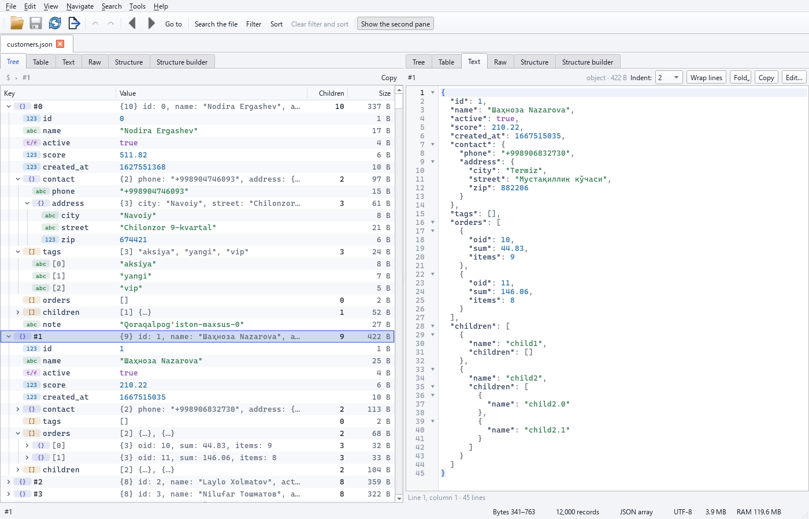

# Katta JSON faylni qanday ochish kerak (1 GB, 2 GB, 5 GB)

Matn muharrirlari va brauzerlar butun faylni RAM'ga yuklashga urinadi, shuning uchun ko'p
gigabaytli JSON fayl ularni muzlatib qo'yadi. jsonreshape hech qachon bunday qilmaydi: u
**faylni bir marta indekslaydi** — har bir yozuvning bayt o'rnini yozib oladi — keyin faqat siz
haqiqatan ko'rayotgan yozuvlarni o'qiydi. 2 GB fayl taxminan **3 soniyada** ko'rishga tayyor bo'ladi.

## Desktop dastur

1. jsonreshape'ni o'rnating ([O'rnatish](../install.md) ga qarang) va `jsonreshape-gui` ni ishga tushiring.
2. **Fayl → Ochish** ni tanlang, faylni oynaga sudrab tashlang yoki Windows'da fayl ustida
   o'ng tugmani bosib **Open with → jsonreshape** ni tanlang.
3. Chapdagi daraxtni ko'rib chiqing — har bir tugun o'z turi va bayt hajmini ko'rsatadi — tanlangan
   yozuv esa o'ngda formatlangan matn ko'rinishida ko'rsatiladi. Aylantirish yozuvlarni kerak bo'lganda yuklaydi.

{ loading=lazy }

## Buyruqlar qatori

```bash
jsonreshape inspect big.json --sample 10000
```

`inspect` yozuvlar sonini, maydonlar va ularning turlarini hamda hajm statistikasini xabar qiladi,
bunda faqat namunani o'qiydi. U standart kirishdan (stdin) ham o'qiy oladi, shuning uchun siqilgan
oqimni diskka chiqarmasdan tekshirishingiz mumkin:

```bash
jsonreshape inspect - < data.json.gz
```

## Nimalarni ocha olasiz

- **JSON massivlar** (`[ {...}, {...} ]`) va yakka katta obyektlar.
- **JSON Lines / NDJSON** (`.jsonl`, `.ndjson`) — har qatorda bitta yozuv.
- **100 MB dan bir necha GB gacha fayllar**. Xotira fayl hajmiga emas, yozuvlar soniga qarab
  o'sadi, shuning uchun u past qoladi — 10 million yozuvni tartiblashda eng yuqori sarf 400 MB dan kam.

## Keyingi qadamlar

- Ochilgan faylni [qidiring, filtrlang va tartiblang](../cli.md).
- Uni [CSV, Excel, SQLite yoki Parquet ga konvertatsiya qiling](convert-json-to-csv-excel.md).
- Uni [boshqa fayl bilan taqqoslang](compare-json-files.md).
